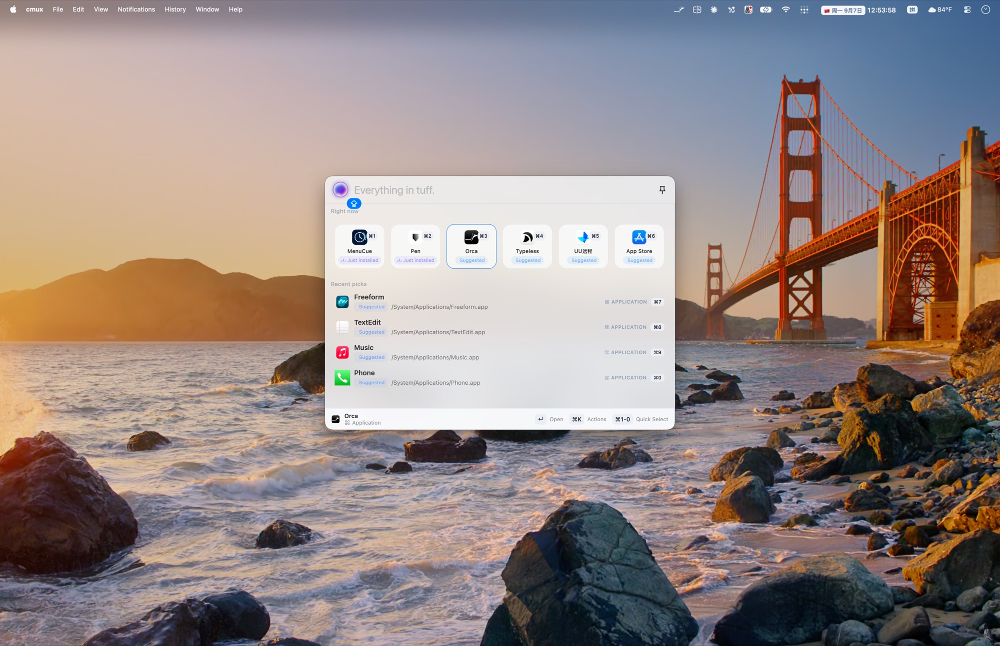

<div align="center">

  

  <h1>Tuff</h1>

  <p><b>Üreticiler için yeniden tasarlanan komut merkezi.</b></p>

  [](https://github.com/talex-touch/tuff/releases)
  [](https://github.com/talex-touch/tuff/releases)
  [](https://github.com/talex-touch/tuff/issues)
  [](./LICENSE)
  [](https://linux.do)

  [Web Sitesi](https://tuff.tagzxia.com) · [İndir](https://github.com/talex-touch/tuff/releases) · [Belgeler](https://tuff.tagzxia.com/docs) · [Eklenti mağazası](https://tuff.tagzxia.com/store)

  [English](./README.md) | [简体中文](./README.zh-CN.md) | **Türkçe**

</div>



## Tuff Nedir?

Tuff (eski adıyla TalexTouch), yerel öncelikli, yapay zeka yerlisi ve genişletilebilir bir masaüstü komut merkezidir. Tek bir klavye odaklı arayüz üzerinden uygulamaları ve dosyaları bulmanıza, komutları çalıştırmanıza, iş akışlarını otomatikleştirmenize ve yönetilen yapay zeka sağlayıcılarını bağlamanıza yardımcı olur.

CoreBox'ı açmak için her yerden <kbd>⌘</kbd> <kbd>E</kbd> (Windows ve Linux'ta <kbd>Ctrl</kbd> <kbd>E</kbd>) tuşlarına basın.

## ⬇️ İndir

Her üç platform için önceden derlenmiş paketler [Releases sayfasında](https://github.com/talex-touch/tuff/releases) yayınlanmaktadır.

| Platform | Paketler |
| --- | --- |
| macOS | `.dmg` / `.zip`, Apple Silicon ve Intel |
| Windows | `.exe` yükleyici (x64) |
| Linux | `.deb` (önerilen) / `.AppImage` |

Ubuntu 24.04 ve üzeri sürümlerde AppImage yerine `.deb` paketinden kurulum yapın. 24.04 sürümü
Electron'un korumalı alanının (sandbox) ihtiyaç duyduğu yetkisiz kullanıcı ad alanlarını varsayılan
olarak kısıtlar; `.deb` paketi kurulum sırasında `userns` izni veren bir AppArmor profili kaydeder,
AppImage'da ise bunu yapabilecek bir kurulum adımı yoktur. AppImage kullanmanız gerekiyorsa, o oturum
için `sudo sysctl -w kernel.apparmor_restrict_unprivileged_userns=0` komutuyla izin verin veya `.deb`
kullanın. Bu durum [#213](https://github.com/talex-touch/tuff/issues/213) kaydında takip edilmektedir
ve ikisinden hangisinin kullanıldığını belirten bir rapor beklenmektedir.

## 📌 Sürüm ve platform durumu

En son kararlı derleme ve mevcut ön sürüm [Releases sayfasında](https://github.com/talex-touch/tuff/releases) listelenmektedir; geliştirme aşamasındaki sürüm ise [kök paket bildirimi](./package.json) ve [CoreApp paket bildiriminde](./apps/core-app/package.json) belirtilen sürümdür. Kesin sürüm numaraları bu README'de bilinçli olarak tekrarlanmaz, böylece bildirimlerden sapması önlenir.

`2.4.14` herkese açık sürüm kapısı kasıtlı olarak katıdır: yayınlanmadan önce macOS, Windows ve Linux'un her biri gerçek kurulum, N→N+1 güncelleme, başlangıç sağlığı ve kurtarma kanıtlarından geçmelidir. Kararlı başlatma/arama ve ayrı ayrı doğrulanmış resmi eklentiler ilk herkese açık kapsamı oluşturur; yapay zeka ve tamamlanmamış kullanıcı arayüzü yüzeyleri açıkça Beta veya kullanılamaz olarak kalır. [Mevcut kararlılık planına](./docs/plan-prd/TODO.md) ve [çapraz platform denetimine](./docs/engineering/reports/search-crossplatform-audit.md) bakın.

Kararlı bir kaynak sürümü her üç platformda da aynı olgunluk düzeyini ifade etmez: platforma özgü yetenekler ve geri dönüş sınırları, o platformun kendi kabul kanıtlarını izler.

## 🚀 Arka Plan

**En güçlü aracınızın sizin kadar uyarlanabilir olması gerektiğine inanıyoruz. Tuff, yeni bir tür komut merkezidir — niyetinizi önceden sezip benzersiz iş akışınıza sorunsuzca entegre olmak üzere tasarlanmış, işletim sisteminiz için temel, açık kaynaklı bir katmandır. Çekirdeğine kadar özelleştirilebilir ve doğası gereği açık olup sizin tarafınızdan şekillendirilmeye hazırdır.**

## 🗻 Özellikler

- **Evrensel arama** — uygulamalar, dosyalar, eklenti eylemleri, hesaplamalar, birimler, para birimleri ve zaman, hepsi CoreBox'tan.
- **Yapay zeka destekli arama** — dosyalar, uygulamalar ve eylemler üzerinde doğal dil sorguları.
- **Bağlamsal zeka** — o anda yaptığınız işe göre proaktif olarak komutlar önerir.
- **Satır içi önizlemeler** — aritmetik, birim, para birimi, zaman ve bilimsel sabit sorguları anında kopyalanabilir kartlar oluşturur.
- **Genişletilebilir** — izin kapılı eklentiler ("Capabilities") ve tipli SDK'lar ana uygulamayı genişletir.
- **Kendi LLM'inizi getirin** — özel bir bulut, barındırılan bir sağlayıcı veya kendi barındırdığınız herhangi bir modeli bağlayın.
- **Temel yardımcı araçlar** — çoklu pencereler, kısayollar, pano yönetimi, ekran görüntüleri, zamanlayıcılar ve daha fazlası.
- **Birleşik indirme merkezi** — merkezi ilerleme takibi ve devam ettirme desteği.
- **Ana uygulama tarafından yönetilen sınırlar** — pano, ekran görüntüsü, iş akışı, indirme ve otomasyon yeteneklerinin tümü izin kapılarının arkasında çalışır.

### Eklenti yönetim politikası

- Resmi pazar yerinden yüklenen eklentilerin bildirimindeki `dev` girişi kurulum sırasında devre dışı bırakılır, böylece yanlışlıkla bir geliştirme sunucusuna bağlanamazlar.
- Her eklentinin kaynağı veritabanında kaydedilir ve kaldırma işlemi eklenti dizinini ve önbelleğe alınmış verilerini de beraberinde siler.

## 🦋 Güzel Kullanıcı Arayüzü Tasarımı

Tuff'ın tasarım stili, sade ve zarif olan TDesignS'ten esinlenmiştir. Kullanıcılara daha iyi bir deneyim sunmak için temalar, yazı tipleri ve simgeler özenle ayarlanmıştır.


## 🍀 Basit ve Kullanımı Kolay İşlemler

Tuff'ın kullanımı oldukça basit ve kullanıcı dostudur; kullanıcıların çeşitli görevleri kolayca tamamlamasına olanak tanır. Tuff'ın sunduğu kolaylıktan yararlanmak için tek yapmanız gereken menü veya kısayol tuşları aracılığıyla gerekli işlevi açmaktır.

## 🔐 Güvenli ve Güvenilir

Kullanıcılarımızın güvenliğine ve gizliliğine büyük önem veriyoruz. Kullanıcı verilerinin sızdırılmayacağını veya kötüye kullanılmayacağını garanti ediyor ve kullanıcı güvenliğini korumak için birden fazla güvenlik mekanizması sunuyoruz.

Kullanımı kolay, çapraz platform ve güzel tasarlanmış bir masaüstü yazılımı arıyorsanız, Tuff en iyi seçiminizdir. Yalnızca zengin işlevsellik sunmakla kalmaz, aynı zamanda açık bir topluluk ekosistemi ile iyi bir kullanıcı deneyimi sağlar. Tuff'ı kullanmaya ve yeni bir masaüstü deneyimi yaşamaya hoş geldiniz!

## 📚 Belgeler

- [Belgeler dizini](./docs/INDEX.md)
- [Mevcut kararlılık planı](./docs/plan-prd/TODO.md)
- [Proje PRD'leri ve yol haritası](./docs/plan-prd/README.md)
- [Katkı rehberi](./.github/docs/contribution/CONTRIBUTING.md)
- [Depo geliştirme talimatları](./AGENTS.md)

## 💚 Topluluk

<a href="https://linux.do"></a>

Tuff'ı şekillendirmeye devam eden ilgi, geri bildirim ve testler için [linux.do](https://linux.do) topluluğuna teşekkürler. Sorular, hata raporları ve eklenti fikirleri hem orada hem de [GitHub Issues](https://github.com/talex-touch/tuff/issues) üzerinden memnuniyetle karşılanır.

## 🤝 Lisans

Bu proje **Mozilla Public License 2.0 (MPL-2.0)** kapsamında açık kaynaklıdır — bkz. [`LICENSE`](./LICENSE).

## ⁉️ Sorun Bildirimi (Issue)

> `issue template` şablonuna uymayan tüm sorun bildirimleri doğrudan kapatılacaktır!

Geliştiricilerin bu projede dahi sorununuzu çözme yükümlülüğü olmadığını ve açık kaynak ile bakım çalışmalarının geliştiricilerin boş zamanlarına dayandığını lütfen unutmayın.

## ❤️ Katkı

### Geliştirme ön koşulları

- Çalışma zamanı, bağımlılık ve derleme aracı sürümleri için [kök paket bildirimi](./package.json), [CoreApp paket bildirimi](./apps/core-app/package.json), [çalışma alanı kataloğu](./pnpm-workspace.yaml) ve [kilit dosyası](./pnpm-lock.yaml) esas alınır.
- Corepack ve kök bildirim tarafından izin verilen bir Node.js sürümü kullanın; bu README'ye kopyalanmış sürüm numaralarına güvenmeyin.

```bash
corepack enable
pnpm install
pnpm core:dev
```

#### [Daha fazla bilgi için buraya tıklayın](./.github/docs/contribution/CONTRIBUTING.md)

### Bizimle kimler çalışıyor

<!-- readme: collaborators,contributors -start -->
<table>
<tr>
    <td align="center">
        <a href="https://github.com/TalexDreamSoul">
            
            <br />
            <sub><b>TalexDreamSoul</b></sub>
        </a>
    </td>
    <td align="center">
        <a href="https://github.com/lorsque-sir">
            
            <br />
            <sub><b>Lorsque</b></sub>
        </a>
    </td>
    <td align="center">
        <a href="https://github.com/fossabot">
            
            <br />
            <sub><b>Fossabot</b></sub>
        </a>
    </td></tr>
</table>
<!-- readme: collaborators,contributors -end -->

## Star History

<a href="https://www.star-history.com/#talex-touch/tuff&Date">
 <picture>
   <source media="(prefers-color-scheme: dark)" srcset="https://api.star-history.com/svg?repos=talex-touch/tuff&type=Date&theme=dark" />
   <source media="(prefers-color-scheme: light)" srcset="https://api.star-history.com/svg?repos=talex-touch/tuff&type=Date" />
   
 </picture>
</a>

## ✉️ İletişim

E-posta (TalexDreamSoul@Gmail) aracılığıyla veya bir issue açarak ulaşabilirsiniz.

Copyright © 2022-PRESENT TalexDreamSoul
