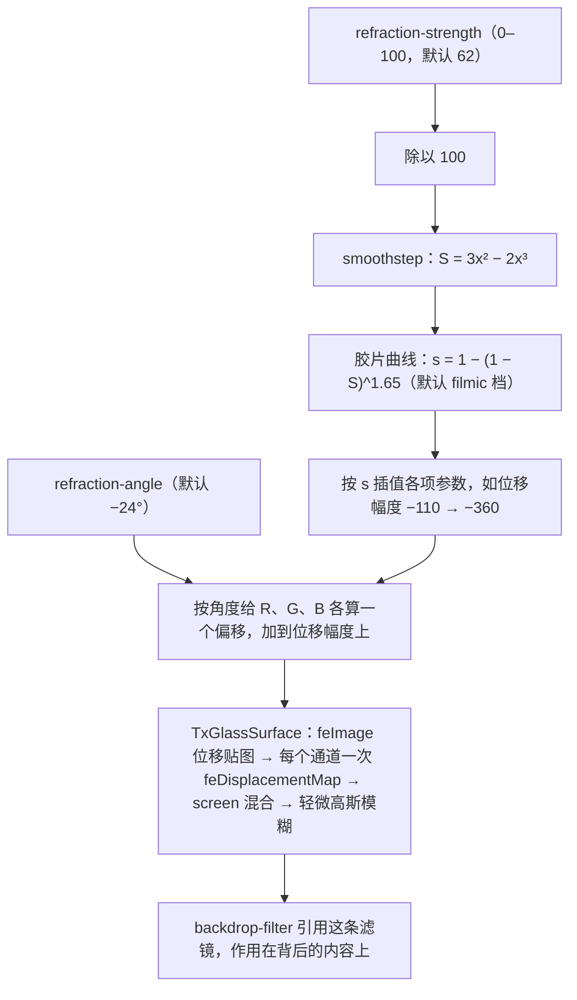
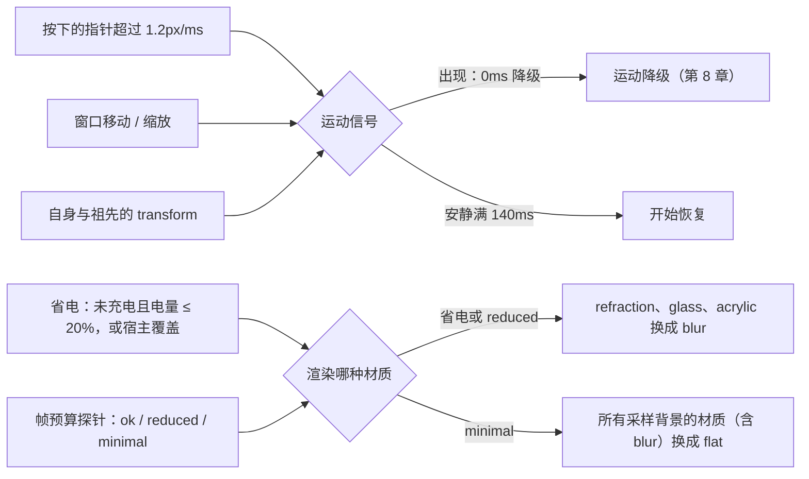
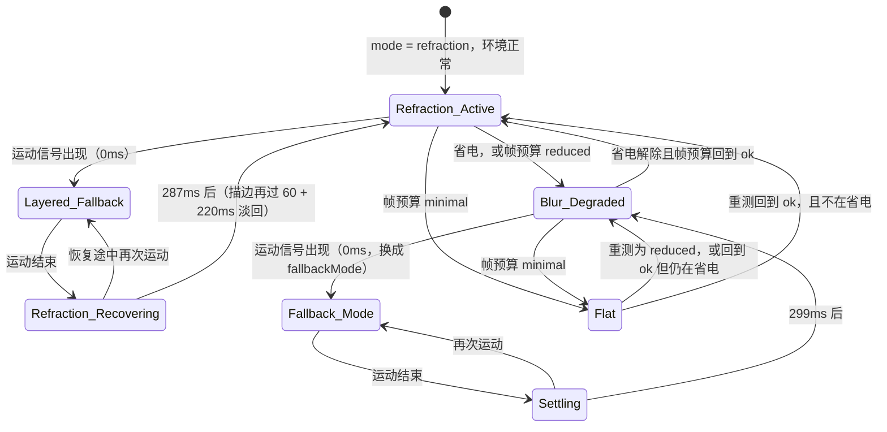

# 第二篇：材质系统、折射着色器与环境自动感知 (Surfaces & Material Physics)

> 涵盖章节：第 5 章 ～ 第 11 章  
> 核心主题：八种 Surface 材质与默认的 `refraction`；琉光折射（Refraction）物理模型；自动环境感知与动态推断；运动自适应降级与分层恢复；噪点掩膜与光斑追踪。

---

## 第 5 章：Surface 材质哲学与选型矩阵

### 5.1 为什么现代专业工具需要物理材质？

扁平化设计（Flat Design）过度剔除了物理暗示，导致界面元素缺乏空间层级感知；而早期拟物化（Skeuomorphism）则充斥着沉重的仿皮纹与浮雕，干扰阅读焦点。

TuffEx 提出的**“次表面材质学”（Sub-surface Materiality）**，借鉴了光学材料物理特性。通过控制光线的透射、折射与微表面散射，在屏幕上建立清晰、轻盈但坚实的空间秩序。

`TxBaseSurface` 的 `mode`（`BaseSurfaceMode`）有 9 个取值，其中 `pure` 与 `flat` 画的是同一种材质，所以一共 8 种。每种由几层叠成：玻璃层（`TxGlassSurface`）用于 `glass` 与 `refraction`，背景滤镜层用于 `blur`、`acrylic` 与 `refraction`，色膜层用于 `mask` 与 `acrylic`，折射描边只在 `refraction` 上；`mica` 与 `flat` 直接画在容器上，`plain` 什么都不画。

| 材质模式 | 渲染管线（默认参数） | 物理隐喻 | 适用场景 | 性能开销 |
|---|---|---|---|---|
| `refraction`（默认） | 玻璃层：SVG 位移贴图让 R、G、B 三个通道各自错开（色散）；其上叠背景模糊与饱和度滤镜层，外加 1px 折射描边。卡片预设（`TxCard`、`TxFlipOverlay`）的滤镜层还带按光源位置排布的高光 | 冰晶 / 棱镜 | 所有带材质层组件的默认材质：卡片、翻转浮层、模态框、抽屉与各类弹出面板 | 最高：两层都采样背景；运动中分层降级（第 8 章） |
| `glass` | 玻璃层：同样的位移贴图与色散，再 `saturate(1.8)`；在 Safari、Firefox 上退回 `blur(10px) saturate(1.8) brightness(1.06)` 与 1px 高光外环 | 棱镜玻璃 | 要折光、不要雾化的小块面板，背景简单时上面的字才读得清 | 低于 `refraction`：只有一层采样背景 |
| `acrylic` | 三倍宽的背景模糊（30px），饱和度 ×1.2、亮度 ×1.06；其上一层 0.6 的色膜，色膜的 alpha 带 140px 平铺的分形噪点（88%～100%） | 漫反射亚克力 | 系统侧边栏、状态面板一类大面积的次级面板（类似 Windows Acrylic） | 高于 `blur`：模糊半径是它的三倍 |
| `mica` | 不透明底：表面色混入 5% 主色，上面两道锚定视口（`background-attachment: fixed`）的宽幅色晕，视口左上角是 12% 的主色，右下角是 8% 的相邻色相（主色色相 +40°）；不读背景 | 云母薄片 | 不滚动的窗口基底底板（类似 Windows 11 Mica） | 极低：不采样背景；但容器每次滚动都要重绘，不要用在会滚动的底板上 |
| `mask` | 半透明色膜（不透明度 0.75），不做模糊 | 墨色薄膜 | `blur`、`glass`、`acrylic` 运动时的默认降级态；高密度列表行 | 低：不采样背景 |
| `blur` | `backdrop-filter: blur(10px) saturate(1.5)`，叠一层 10% 的浮层底色 | 雾化毛玻璃 | 低端核显与省电环境：`autoDetect` 在省电或帧预算 `reduced` 时把 `refraction`、`glass`、`acrylic` 换成它（第 7 章） | 中等：采样一次背景 |
| `flat`（同 `pure`） | 不透明实色（`--tx-fill-color-lighter`），背景完全不透出 | 坚硬塑料底板 | 高对比度模式（除 `plain` 外的材质都按它绘制）、帧预算 `minimal` 时的降级目标、要求完全不透明的底盘 | 最低 |
| `plain` | 不画任何材质层，只保留圆角与溢出裁切；高对比度下也不加底色 | 空无一物 | 只需要圆角与裁切的逻辑布局容器 | 零 |

### 5.2 默认材质一律为 `refraction` 的严肃铁律

在 TuffEx 体系中，**带材质层的容器默认材质一律为 `refraction`（琉光/折射）**。组件的默认值都照这条规则取：`TxBaseSurface` 的 `mode`、`TxCard` 的 `background`、`TxFlipOverlay`、`TxModal`、`TxDrawer`、`TxCommandPalette` 与 `TxPopperDialog`、`TxBlowDialog`、`TxBottomDialog`、`TxTouchTip` 几种对话框的 `surface`，以及 `TxPopover`、`TxTooltip`、`TxDropdownMenu` 与 `TxContextMenu`（及各自的子菜单）、`TxSelect`、`TxSearchSelect` 这些弹出面板的 `panelBackground`（它们都经 `TxBaseAnchor` 渲染）。

core-app 的 CoreBox 同样铺 `refraction`，但它是透明窗口，模糊来自窗口自身的系统材质（macOS 的 vibrancy、Windows 的 Mica）。页面里的 `backdrop-filter` 采不到这层材质，只会把表面自己的底色再采一遍、叠在原底色上，直到它不再透明；所以 CoreBox 的表面开着 `systemBackdrop`：不跑任何 `backdrop-filter`，模糊交给系统，表面只铺底色、光与描边。

> **硬性门禁准则**：若因特殊场景需要把材质（`mode`、`background`、`surface`、`panelBackground`）从 `refraction` 换成别的（如 `flat` / `mask` / `glass` / `acrylic` / `mica`），**必须经过用户手动明确确认**，不得由 AI 或开发人员擅自替换默认材质。
> 这一铁律确保了全局视觉的一致性，防止多个开发者或 Agent 各自为政造成界面碎片化。

运行期的临时换材质不算切换：运动中的 `fallbackMode`，以及 `autoDetect` 在省电、掉帧时的降级（第 7、8 章），都不改组件声明的材质，条件解除后自动回到原材质。

---

## 第 6 章：折射材质（Refraction）渲染管线与色散模型

### 6.1 斯涅尔定律与色散物理模拟

当光线从空气进入高折射率介质时，根据斯涅尔定律（Snell's Law）：
$$n_1 \sin\theta_1 = n_2 \sin\theta_2$$
光线方向发生偏折。由于不同波长的光折射率不同（色散现象，Dispersion）：
$$n_{\text{Blue}} > n_{\text{Green}} > n_{\text{Red}}$$
白光折射后在边缘处会分解出红蓝偏移的微弱光谱色相（Chromatic Aberration）。`TxBaseSurface` 的 `refraction` 模式以 `TxGlassSurface` 为玻璃层：一条 SVG 位移贴图滤镜让 Red、Green、Blue 三个通道各自位移一次，三次的位移幅度略有不同（默认 scale 依次为 −180、−170、−160），通道错开后在折射边缘分离出微弱的光谱彩边，在纯 Web 技术栈中还原光学质感。



只有传了 `refraction-strength`、`refraction-angle`、`refraction-profile` 三者之一，组件才走上面这套强度模型；否则用固定的默认参数（位移幅度 −180，三个通道依次 −180、−170、−160）。

### 6.2 强度平滑模型：Smoothstep 曲线

为了避免折射强度在低数值时突变、高数值时失真，`TxBaseSurface` 收到 `refraction-strength` 后先除以 100，再过计算机图形学经典的 `smoothstep` 曲线，之后按 `refraction-profile` 再过一条胶片曲线：

```ts
// packages/tuffex/packages/components/src/base-surface/src/base-surface-math.ts
export function smoothstep01(value: number) {
  const t = clamp(value, 0, 1)
  return t * t * (3 - 2 * t)
}

// packages/tuffex/packages/components/src/base-surface/src/TxBaseSurface.vue
const filmicRefractionStrength = computed(() => {
  const eased = smoothstep01(normalizedRefractionStrength.value)
  if (resolvedRefractionProfile.value === 'soft') {
    return 1 - (1 - eased) ** 1.15
  }
  if (resolvedRefractionProfile.value === 'cinematic') {
    return 1 - (1 - eased) ** 2.2
  }
  return 1 - (1 - eased) ** 1.65
})
```

`smoothstep` 两端斜率为 0，强度在起点和终点附近变化很慢，不会一推就跳。各项参数最后按胶片曲线的结果在两端之间插值，例如默认 `filmic` 档的位移幅度从 −110 走到 −360，所以强度为 0 时仍保留 −110 的位移。

### 6.3 位移贴图与浏览器回退

玻璃层的位移贴图不是 `feTurbulence` 噪声，而是 `feImage` 引用的一张按元素尺寸生成的 SVG：红色水平渐变、蓝色垂直渐变，中间一块模糊的灰色。灰色里各点位移相同，只是整体平移，弯折集中在边缘一圈；元素尺寸变化时 `ResizeObserver` 会重新生成这张贴图。滤镜以 `backdrop-filter: url(#…)` 作用在背后的内容上，Safari 与 Firefox 不走这条滤镜，退回 `backdrop-filter` 背景模糊。

---

## 第 7 章：材质的动态推断与环境感知系统 (Automatic Surface Deduction)

### 7.1 为什么不能依靠人工切换材质？

折射与背景模糊都靠 `backdrop-filter` 采样身后的内容。材质随元素一起移动时，取样会落后于元素的位置，滤镜层拖着一块错位的背景走；在 120Hz（ProMotion）屏幕上拖动窗口时，重滤镜还会挤占本就只有 8.3ms 的帧预算。而桌面客户端的运行时环境本身是高度波动的：
1. 用户可能正以 120Hz 高刷新率拖拽窗口。
2. 笔记本可能拔掉电源，在电量低时进入省电模式。
3. 机器可能在老旧核显上运行，跑不动重度滤镜、连续掉帧。

如果依靠业务代码手动判断并降级材质，必然导致代码充斥大量环境分支判断，也极易遗漏。TuffEx 把这套判断收进 `TxBaseSurface` 的**环境感知自动推断（`autoDetect`，默认关闭）**。

宿主也可以不开它，自己设置 `moving` 属性。TuffEx 里，`TxBaseAnchor` 的弹出面板在部分打开、关闭动画期间设置它（`surfaceMotionAdaptation` 默认 `auto`），`TxFlipOverlay` 在翻转动画期间设置它，`TxCard` 在惯性跟随（`inertial`）运动期间设置它。

```vue
<!-- 宿主自己知道何时在动：直接传 moving -->
<TxBaseSurface :moving="dragging" />

<!-- 交给环境感知：指针、窗口、自身与祖先的 transform、帧预算、省电 -->
<TxBaseSurface auto-detect />
```

### 7.2 感知信号矩阵与推断逻辑

打开 `autoDetect` 后，组件综合以下运行期信号。除第 3 条外都是页面级的：所有打开 `autoDetect` 的材质共用一套监听，监听、电池订阅与帧探针只在至少有一个这样的材质挂载时存在。
1. **指针速度感知**：只看按下状态的指针。相邻两次采样至少间隔 16ms，速度取 $|\vec{v}| = \frac{\|\Delta \vec{s}\|}{\Delta t}$，一次采样超过 $1.2\text{px/ms}$ 即判定为快速移动。没按下的悬停移动不算；按住不动或放慢后，140ms 内没有新的快速采样，信号结束。
2. **窗口移动与缩放感知**：页面自己的 `resize` 事件自动计入。网页收不到窗口移动的事件，要由宿主转发：在 Electron 里把 `BrowserWindow` 的 `move`（以及 `will-move`）转给渲染进程，调用 `notifySurfaceWindowMotion()`。最后一次报告后 140ms，信号结束。
3. **自身与祖先的 transform**：在材质元素及其所有祖先上监听 `transform` / `translate` 的 `transitionstart`、`transitionend`、`transitioncancel`，只认发生在这些元素自身的过渡，从别处冒泡上来的不算；`MutationObserver` 观察它们的内联 `style`，任一元素带内联 `transform` 即视为运动，全部去掉后视为停止。
4. **渲染帧率探针（Frame Budget Probe）**：挂载后趁空闲采样约 30 帧（最多 3 秒），以最快的一成帧间隔估计这块屏幕的帧预算（不超过 16.67ms，120Hz 屏上约 8.3ms）。三分之一以上的帧超过 1.5 个预算记为 `reduced`；中位帧超过 2.5 个预算记为 `minimal`；中位帧超过 250ms 说明页面正被浏览器节流，这次读数作废。降级后依次隔 30、60、120、300 秒重测，恢复后 1.5 秒再确认一次；页面隐藏或失去焦点时不测。
5. **省电信号**：通过 Battery Status API，未充电且电量不高于 20% 视为省电。宿主可以用 `setSurfacePowerSaving(true | false)` 覆盖（例如接 Electron 的 `powerMonitor`），传 `null` 交还给电池接口。

前三条是运动信号，决定**何时**降级（第 8 章）；后两条决定**渲染哪种材质**：



`mica`、`plain`、`pure`、`mask` 不受影响。降级只改渲染出来的材质，不改组件声明的 `mode`，条件解除后自动回到原材质。

`getSurfaceEnvironment()` 以只读 ref 给出页面当前的 `pointerMoving`、`windowMoving`、`powerSaving` 与 `frameTier`，阈值以 `SURFACE_POINTER_SPEED_THRESHOLD`、`SURFACE_MOTION_SETTLE_MS`、`SURFACE_LOW_BATTERY_LEVEL` 导出。宿主把原生信号接进来只需两个调用：

```ts
import { notifySurfaceWindowMotion, setSurfacePowerSaving } from '@talex-touch/tuffex'

// 主进程把 BrowserWindow 的 move（及 will-move）转发到渲染进程后，每收到一次调用一次
notifySurfaceWindowMotion()

// 宿主自己掌握电源状态时（如 Electron 的 powerMonitor）
setSurfacePowerSaving(true) // false 关闭；null 交还给 Battery Status API
```

---

## 第 8 章：运动降级与渐进恢复曲线

### 8.1 120Hz 拖拽：降级不等待，恢复有迟滞

在窗口拖拽或卡片飞入动画中持续计算重度 SVG 位移贴图折射滤镜，滤镜层会拖着错位的背景走，还要和拖动本身争抢 120Hz 下只有 8.3ms 的帧预算。

TuffEx 的策略是：**“运动时瞬间隐退，静止后分层恢复”**，靠一只**非对称时钟**：
- **降级（0ms）**：任一运动信号出现，当帧降级，不做防抖。重滤镜立刻让出 GPU，拖动跟手。
- **恢复（140ms 迟滞）**：信号消失后不立即切回，防止手势在阈值附近轻微颤抖时反复切换；等 140ms 内没有新信号，才开始恢复。

`autoDetect` 的每一路运动信号（指针、窗口、自身与祖先的 transform）都走这只时钟，它也以 `useSurfaceMotionGuard` 导出：

```ts
// packages/tuffex/packages/components/src/base-surface/src/surface-environment.ts（节选）
export function useSurfaceMotionGuard(
  emitFallback: (isFallback: boolean) => void,
  options: SurfaceMotionGuardOptions = {},
): SurfaceMotionGuard {
  const settleMs = Math.max(0, options.settleMs ?? SURFACE_MOTION_SETTLE_MS) // 默认 140
  let active = false
  let settleTimer: ReturnType<typeof setTimeout> | null = null

  function onMotionStart() {
    clearSettle()
    // 0ms：当帧降级，释放重滤镜占用的 GPU
    if (!active) {
      active = true
      emitFallback(true)
    }
  }

  function onMotionEnd() {
    // 已有待定的结束就保留它的期限：安静时间从第一次停下算起
    if (!active || settleTimer != null)
      return
    // settleMs 为 0 时同步结束（此处略）；否则安静满 settleMs 才恢复
    settleTimer = setTimeout(() => {
      settleTimer = null
      active = false
      emitFallback(false)
    }, settleMs)
  }

  // 在 effect scope 里创建时，随 scope 自动取消待定的结束
  if (getCurrentScope())
    onScopeDispose(clearSettle)

  return { onMotionStart, onMotionEnd, dispose: clearSettle }
}
```

`emitFallback` 只在状态变化时调用。知道自己何时运动的宿主，可以直接用它驱动 `moving`：

```ts
import { useSurfaceMotionGuard } from '@talex-touch/tuffex'

const moving = ref(false)
const guard = useSurfaceMotionGuard((value) => {
  moving.value = value
})
// 开始拖动：guard.onMotionStart()，立即回调 true
// 停止拖动：guard.onMotionEnd()，安静满 140ms 后回调 false
```

```vue
<TxBaseSurface :moving="moving" />
```

### 8.2 blur、glass 与 acrylic：整体换材质

下文的“运动结束”，对 `autoDetect` 而言是 140ms 迟滞之后；对 `moving` 而言是宿主把它置回 `false` 的时刻。

- **降级**：运动一开始，渲染模式立即换成 `fallbackMode`。默认是 `mask`，色膜不透明度取 `fallbackMaskOpacity`（`TxBaseSurface` 默认 0.95，`TxCard` 传 0.26）；也可以设为 `pure`。
- **恢复**：运动结束后先保持降级 `max(transitionDuration, settleDelay)`，默认 `max(299, 150)` = 299ms，再换回原材质。

### 8.3 refraction：分层降级、分层恢复

`refraction` 不换材质，而是分层降级：
- **降级**：玻璃层和滤镜层在 140ms 内淡出，一层半透明遮盖在 180ms 内升到 0.55，折射参数的混合进度降到 0.28，折射描边立即隐藏。
- **恢复**：运动一结束就开始，没有等待期。参数在 182ms 内回满；遮盖先停 60ms，再用 227ms 撤完，到 287ms 结束；玻璃层和滤镜层延迟 80ms 后用 220ms 淡回；恢复结束后再过 60ms，描边用 220ms 淡回。恢复途中再次运动，会直接回到降级状态。

`pure`、`mask`、`flat`、`mica`、`plain` 没有采样背景的滤镜层，运动时不做任何处理。

### 8.4 状态机



`mode` 本身就是 `blur`、`glass` 或 `acrylic` 的材质，静止时保持原材质，运动时同样走 `Fallback_Mode` 与 `Settling` 这一圈。运动中的材质因此不会拖着错位的背景走，停下后又回到完整的折射。

---

## 第 9 章：亚克力、云母与折射玻璃的平台边界

### 9.1 平台体系横向对比

| 体系 | 代表材质 | 光学原理 | 核心优势 | 缺陷与局限 |
|---|---|---|---|---|
| **Apple** | Liquid Glass（2025 年随 macOS Tahoe 26 等推出）与标准材质（AppKit 的 `NSVisualEffectView`） | 标准材质模糊并透出背后的内容，再加 vibrancy：把前景与背景的颜色混合以拉开对比，灰度前景效果最好。Liquid Glass 是控件与导航层的半透明材质，反射、折射周围的内容；常用的 regular 变体模糊背景并调整亮度，保证文字可读 | 系统统一绘制，AppKit 控件自动加 vibrancy；跟随「减少透明度」「增强对比度」等系统设置 | 只在 Apple 平台。网页拿不到，Electron 只能给整个窗口设 `vibrancy`：Tuff 的窗口在 macOS 上就用 `fullscreen-ui` 垫底 |
| **Microsoft Fluent** | Mica（云母）/ Acrylic（亚克力） | Mica 不透明，按主题给桌面壁纸染色，铺在长驻窗口的背景上；Acrylic 由背景、模糊、排除混合、染色、噪点五层叠成 | Mica 只采样一次壁纸，开销很小；窗口失焦时退回中性色，帮用户分辨哪个窗口在前 | Acrylic 吃 GPU、耗电，不建议铺在应用的大面积背景上；关掉「透明效果」或进入节电模式时，两者都退回纯色。Tuff 的窗口在 Windows 上用 Mica 垫底 |
| **Google Material 3** | Surface Container 色阶 | 不透明的纯色，按层级取同一色系里明度不同的色调。早期按高度叠加半透明的主色（surface tint），现已换成不随高度变化的色调角色 | 没有模糊和透明，几乎没有渲染开销，各平台一致 | 透不出背后的内容，层次只靠色调与阴影区分 |
| **Tuff / TuffEx** | **Refraction (琉光)** | **SVG 位移贴图分通道位移（色散光谱偏移）+ 背景模糊与饱和度滤镜层 + 1px 折射描边** | **纯 Web 技术栈（SVG 滤镜 + `backdrop-filter`）实现，桌面端与 Nexus 共用一套** | **SVG 位移滤镜只在 Chromium 内核生效，Safari、Firefox 退回背景模糊；材质移动时必须降级** |

---

## 第 10 章：噪点掩膜与微质感物理着色

### 10.1 为什么传统混合模式（Overlay / Soft-light）会发灰？

许多设计教程推荐给磨砂玻璃添加 5% 的白色或黑色噪点，并使用 CSS `mix-blend-mode: overlay`。
在浅色或极低透明度的底色上，这种做法是灾难性的：
$$\text{Overlay}(A, B) = \begin{cases} 2AB & B < 0.5 \\ 1 - 2(1-A)(1-B) & B \ge 0.5 \end{cases}$$
在 16% 左右的极淡色洗（Wash）上，噪点会让原本清透的色彩像素瞬间蒙上一层**脏灰色的噪斑**，在 Retina 2x 高清屏上尤为刺眼。

### 10.2 TuffEx 解决方案：`mask-composite: intersect` Alpha 噪点

TuffEx 不去改变像素颜色，而是**将噪点直接编织进透明度通道（Alpha Channel）**：

```scss
// 正确：通过掩膜交集将噪点注入到透明通道，背景色彩永不发灰
@supports (mask-composite: intersect) {
  .tx-status-hint__wash {
    background-color: var(--tx-status-hint-accent, #67c23a);
    // 线性渐变与分形噪点进行交集合成
    mask-image:
      linear-gradient(
        to right,
        rgb(0 0 0 / var(--tx-status-hint-wash-strength, 0.26)),
        rgb(0 0 0 / calc(var(--tx-status-hint-wash-strength, 0.26) * 0.45)) 38%,
        transparent
      ),
      $grain; // 140px 见方的 feTurbulence 分形噪点 SVG
    mask-size: 100% 100%, 140px 140px;
    mask-repeat: no-repeat, repeat;
    mask-composite: intersect;
  }
}
```

这样，噪点只决定“当前色彩透出多少”，底层背景的干净程度完全不受污染。噪点的 alpha 平均约 0.6，所以前缘 0.26 的强度在浅色主题里约合 16%；暗色主题取 0.2，因为同样的色调在深色页面上更显眼。

---

## 第 11 章：物理光源追踪与动态光斑

### 11.1 卡片动态反光（Specular Follow）

在 `TxCard` 组件中，用户移动鼠标时，卡片表面会有一束跟随光标移动的微弱反光；光斑掠过边框时，边框那一圈再亮起一道更窄、更亮的光，像光线擦过倒角，形成物理世界微晶材质的立体感。反光由 `specular` 控制，不传时跟随 `clickable`：可点击的卡片默认带反光，其余卡片默认不带；`disabled` 的卡片不画。

```vue
<!-- 可点击的卡片默认就有反光；其他卡片显式打开 -->
<TxCard clickable>…</TxCard>
<TxCard specular>…</TxCard>
```

反光是材质之上、内容之下的一层（`z-index` 与材质同为 0，排在材质之后）：

```vue
<!-- packages/tuffex/packages/components/src/card/src/TxCard.vue -->
<div
  v-if="specularEnabled"
  class="tx-card__specular"
  :class="{ 'is-lit': specularLit }"
  :style="{ '--tx-card-light-x': `${specularX}%`, '--tx-card-light-y': `${specularY}%` }"
  aria-hidden="true"
/>
```

```scss
.tx-card__specular {
  position: absolute;
  inset: 0;
  z-index: 0;
  display: none;
  pointer-events: none;
  opacity: 0;
  background: radial-gradient(
    600px circle at var(--tx-card-light-x, 50%) var(--tx-card-light-y, 50%),
    color-mix(in srgb, var(--tx-color-white, #fff) 6%, transparent),
    transparent 40%
  );
  transition: opacity 240ms ease-out;

  &.is-lit {
    opacity: 1;
  }

  // 边框那一圈：240px、30% 的白光，只画在边框占的环里
  &::after {
    content: '';
    position: absolute;
    inset: calc(-1 * var(--tx-card-border-width, 0px));
    padding: var(--tx-card-border-width, 0px);
    background: radial-gradient(
      240px circle at var(--tx-card-light-x, 50%) var(--tx-card-light-y, 50%),
      color-mix(in srgb, var(--tx-color-white, #fff) 30%, transparent),
      transparent 70%
    );
    mask: linear-gradient(#000 0 0) content-box exclude, linear-gradient(#000 0 0);
  }

  @media (prefers-reduced-motion: reduce) {
    transition: none;
  }
}

:is([data-theme='dark'], .dark) .tx-card__specular {
  display: block;
}
```

- **相对坐标采样**：指针在卡片上移动时，组件把光标位置换算成卡片内 0–100% 的坐标，作为光斑的目标点，写进 `--tx-card-light-x/y`。
- **指数平滑**：光斑不直接跳到指针下，而是每帧追上剩余距离的一部分，按 60Hz 每帧 18%：$P \leftarrow P + (P_{\text{target}} - P)\left(1 - (1 - 0.18)^{\Delta}\right)$。Δ 与 11.3 的弹簧相同，是帧间隔除以 16.67ms，所以 120Hz、144Hz 屏幕上的拖尾与 60Hz 一致；离目标不到卡片尺寸的 0.05% 时对齐，循环随之停止。
- **进出**：指针移入时光斑直接出现在指针下，不从上次离开的地方滑过来；`opacity` 用 240ms `ease-out` 淡入，指针离开后同样淡出。
- **减少动态效果**：`prefers-reduced-motion: reduce` 时光斑始终直接落在指针下，也不做淡入淡出。
- **只在暗色主题绘制**：6% 的白只在深色表面上看得出来，浅色主题不画；高对比度模式下隐藏；虚线边框（`dashed`）不画边框那一圈，免得连虚线的空隙一起点亮。

这种高光不是静态贴图，而是跟随指针的动态照明。它在 6% 的极低不透明度下工作，提供恰到好处的精细反馈，绝不夺取内容的主角地位。

### 11.2 折射光源跟随

`TxCard` 的折射光源跟随默认关闭，只在 `background` 为 `refraction`（默认值）且打开 `refraction-light-follow-mouse` 时工作：

```vue
<TxCard refraction-light-follow-mouse>
  <!-- 卡片内容 -->
</TxCard>
```

- **相对坐标采样**：指针在卡片上移动时，组件把光标位置换算成卡片内 0–1 的归一化坐标，作为光源的目标点；指针离开卡片，目标点回到中心 (0.5, 0.5)。
- **移动折射的光源点**：光源点经 `TxBaseSurface` 的 `refraction-light-x/y` 写成 `--tx-surface-refraction-light-x/y`，决定折射滤镜层与色膜层上几处径向光晕的位置，其中一处落在对角的对称点上。它只移动材质自带的光晕，不另加高光层，与 11.1 的反光互不相干，两者可以同时打开。
- **随指针微调强度与角度**：光源离中心越远，折射强度最多加 16 × `refraction-light-follow-intensity`（默认 0.45，即最多 +7.2）；折射角度按同一系数向指针方向插值。

### 11.3 弹簧平滑

为了防止鼠标快速移动时光斑机械跳动，光源点不直接跳到目标点，而是由一根逐帧积分的弹簧带过去：
$$v \leftarrow \left(v + k\,(P_{\text{target}} - P)\,\Delta\right) c^{\Delta}, \qquad P \leftarrow \operatorname{clamp}(P + v\,\Delta,\ 0,\ 1)$$
k 是 `refraction-light-spring-stiffness`（默认 0.15，取值限制在 0.01–0.55），c 是 `refraction-light-spring-damping`（默认 0.6，限制在 0.55–0.99），Δ 是帧间隔除以 16.67ms（限制在 0.1–2，第一帧取 1）。位置差与速度都小于 0.002 时视为停稳，循环随之停止。关掉 `refraction-light-spring`，光源点直接跳到目标点。按 60Hz 推算，默认参数下一次跳变只冲过目标约 3%，约 130ms 后稳定在 5% 以内。位置这一步也乘 Δ，所以 120Hz、144Hz 屏幕上光源点的走法与 60Hz 基本一致。
