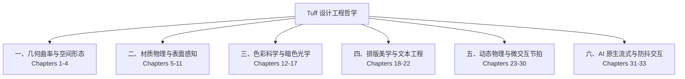

# Tuff & TuffEx 设计概念与工程哲学 (Design Concepts)

> 适用范围：Tuff 桌面端、Nexus 平台、TuffEx 基础组件库与官方插件体系。  
> 核心参照：Apple Human Interface Guidelines (空间隐喻与光学平滑)、Google Material Design 3 (自适应动态与语义色彩)、Microsoft Fluent Design System (物理材质与光照系统)。

---

## 知识体系全景

Tuff 的设计体系不是简单的样式规范罗列，而是建立在**人机感知物理学**、**流式现代计算**与**生产力工程纪律**之上的严密契约。

本手册系统性阐述 Tuff & TuffEx 每一个设计决策背后的“为什么”与“怎么做”，涵盖 6 大维度、共 33 个核心章节，并配以大量实际工程代码、数学几何推导与正反比照。

---

## 33 章节导航索引

### [第一篇：几何、曲率连续性与空间形态](./01-geometry-and-curvature.md)
* **第 1 章：曲率连续性原理：从 G0、G1 到 G2 连续**（数学推导、圆弧倒角的视觉断裂、超椭圆 Squircle 方程式、Apple 平滑圆角对比）
* **第 2 章：同心圆角法则与黄金嵌套比**（$R_{\text{outer}} = R_{\text{inner}} + \text{Padding}$ 几何守恒、视觉挤压预防）
* **第 3 章：内外微内嵌与光学校准**（水平内嵌避开曲率拐点、光标裁剪规避、垂直/水平内边距 0.65x 黄金光学比例）
* **第 4 章：空间层级与 Z-Axis 深度拓扑**（消除 `z-index: 99999` 混乱、浮层按打开顺序取号、吸顶分割线的边界准则）

### [第二篇：材质系统、折射着色器与环境自动感知](./02-surfaces-and-materials.md)
* **第 5 章：Surface 材质哲学与选型矩阵**（8 种材质划分与性能开销、Refraction 默认统治地位与严肃确认门禁）
* **第 6 章：折射材质（Refraction）渲染管线与色散模型**（斯涅尔定律、SVG 位移贴图滤镜、Smoothstep 与胶片曲线强度映射、分通道色散）
* **第 7 章：材质的动态推断与环境感知系统（Automatic Surface Deduction）**（`autoDetect` 运作机理：指针速度传感、窗口拖拽捕获、帧预算探测与省电降级；宿主自己传入的 `moving`）
* **第 8 章：运动降级与渐进恢复曲线**（120Hz 拖拽下 0ms 降级与 140ms 迟滞恢复、blur / glass / acrylic 换成 `fallbackMode` 后 299ms 恢复、refraction 分层降级与 287ms 分层恢复）
* **第 9 章：亚克力、云母与折射玻璃的平台边界**（对比 Windows Fluent 的 Mica / Acrylic、Apple 的 Liquid Glass 与 vibrancy、Material 3 的色调层级与 TuffEx Refraction）
* **第 10 章：噪点掩膜与微质感物理着色**（为什么叠加混合会发灰？`mask-composite: intersect` 的 Alpha 噪点方案）
* **第 11 章：物理光源追踪与动态光斑**（卡片 `specular` 反光随光标追踪与指数平滑、TxCard 折射光源随指针移动、逐帧积分的弹簧平滑）

### [第三篇：色彩科学、暗色模式与感知光学](./03-color-science-and-dark-mode.md)
* **第 12 章：为什么是 `#141414`：中性深灰与纯黑之辩**（OLED 像素拖尾陷阱、黑色压迫感、三层表面堆叠阶梯）
* **第 13 章：暗色模式视网膜光晕效应与字重视觉补偿**（赫姆霍兹光渗效应、白字看起来更粗、暗色主题 460/560/660 字重微调与静态字体陷阱）
* **第 14 章：双极性语义着色与 `color-mix` 墨水融合**（`-light-9` 黑暗变色原理、对比度 4.5:1 守恒公式、四套主题块实测）
* **第 15 章：加色与减色混合：深浅主题的光学裂变**（`plus-lighter` 在浅色表面的发灰灾难、浅色面换序的色相顺序）
* **第 16 章：无障碍对比度工程：WCAG APCA 与 4.5:1 铁律**（正文 13px 必须使用 `regular`、禁止单靠色相传达状态）
* **第 17 章：高对比度模式与系统级偏好响应**（样式里的十六进制颜色由 `audit:colors` 拦截、浅深两套高对比调色板与材质降级）

### [第四篇：排版美学、字体工程与排版节奏](./04-typography-and-text-engineering.md)
* **第 18 章：13–14px 界面基准与字阶梯层级**（生产力工具与营销页面的本质区别、阅读疲劳与信息扫读密度）
* **第 19 章：无衬线与等宽字体的 X 高度调和**（行内代码为什么缩到约 `0.9em`、`tx-inline-code` 标准样式、恰好对齐要多少）
* **第 20 章：现代软换行与孤字规避（`text-wrap: pretty` & `balance`）**（`balance` / `pretty` 的浏览器支持、TuffEx 文本工具类与流式生成例外、禁止插入硬 ` `）
* **第 21 章：字距调整禁忌：正文零 Tracking 铁律**（正文字距改动的危害、仅允许的三类微型大写/展示数字特例）
* **第 22 章：跨语言与中西文混排节奏**（中英文空格、引号/破折号排版纪律、字体回退链）

### [第五篇：微动态、物理弹簧与交互节拍](./05-motion-and-micro-interactions.md)
* **第 23 章：为什么要做“小 motion”：生产力工具的响应纪律**（动画是状态锚点不是娱乐展示、零阻碍交互核心守则）
* **第 24 章：瞬时悬停原则：Sub-100ms 交互防迟滞**（悬停必须 0ms 瞬间响应、仅状态形变时才启用过渡）
* **第 25 章：菜单与动作确认律动：90ms 清除 + 90ms 激活**（解决点击即消失的不确定感、两拍式微交互节奏）
* **第 26 章：合成器线程优先：零排版动画保障**（仅允许 `translate/scale/rotate/opacity`、不给自定义属性做关键帧动画）
* **第 27 章：物理弹簧引擎 vs 贝塞尔曲线**（贝塞尔在手势打断下的生硬缺陷、TuffEx 阻尼振荡参数模型）
* **第 28 章：折叠展开尺寸保持原则**（容器剪裁 vs 内容缩放、避免文字折行抖动的工程模式）
* **第 29 章：双 Keyframe 名字交替重放机制**（避免 `void el.offsetWidth` 强制重排的 CSS 重播技巧）
* **第 30 章：减弱动态偏好（Reduced Motion）零损降级**（不仅关动画还要保终态、即时完成的极速无感切换）

### [第六篇：AI 原生交互、流式节拍与防抖渲染](./06-ai-native-streaming-interfaces.md)
* **第 31 章：流式文字节拍器：Pacer 架构与微渐显**（Token 到达抖动缓冲、`wordMs` / `maxLagMs` 调度算法与 Aurora 微渐显）
* **第 32 章：流式生成中的稳定高度与防跳动**（Reserve 隐藏镜像层技术、重放时锁定最终高度）
* **第 33 章：可交互性底线：动画绝不阻断阅读与复制**（文字生成阶段即时框选、自由复制、零延迟文本节点落地）

---

## 核心设计法则三要件 (The Design Axioms)

1. **真实度（Physical Honesty）**：界面的每一个圆角、折射、阴影和光照都具备一致的几何与光学逻辑，拒绝无意义的滤镜堆砌与装饰性发光。
2. **零迟滞（Sub-100ms Velocity）**：为专业生产力而生，所有交互反馈在 100ms 内完成视觉落定，所有高频动效只用合成器线程能独立完成的属性（`translate` / `scale` / `rotate` / `opacity`）。
3. **确定性（Deterministic Discipline）**：所有色彩与间距严格来自 Token 体系，业务层严禁局部 Hack 覆盖，保障系统规模扩展与多 Agent 协同演进。
