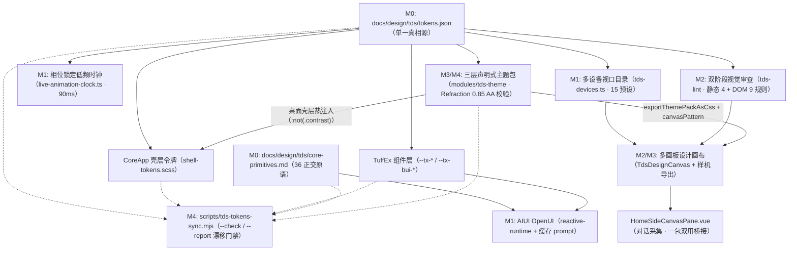

# TDS（Tuff Design System）架构与收敛索引

> 更新时间：2026-11-26
> 定位：Tuff 桌面端（CoreApp）、Nexus 站点、TuffEx 组件库、AIUI（OpenUI）与设计画布共享的视觉体系、设计令牌、审查探针、主题包与自动化漂移门禁总索引（M0–M4）。

---

## 1. M0–M4 架构全景



---

## 2. 目录与权威文件映射

### 2.1 M0：单一真相源与核心原语

| 文件 | 角色 | 机器校验 |
| --- | --- | --- |
| [tokens.json](./tokens.json) | **单一真相源（SoT）**：四套主题色板、字阶、圆角、间距、阴影、动效、Refraction 材质参数、`--shell-*` ↔ `--tx-*` 收敛映射与实测对比度契约 | `shell-tokens.contract.test.ts` |
| [core-primitives.md](./core-primitives.md) | **36 个正交核心原语子集**、特化升级对照表与人类/LLM 共享的紧凑 Schema 约束 | `shell-tokens.contract.test.ts` 校验 36 个模块目录存在性 |
| `apps/core-app/src/renderer/src/styles/shell-tokens.scss` | CoreApp 壳层 CSS 变量落点（`:root`、`.dark`、`html.contrast`、`html.dark.contrast`） | 与 `tokens.json` 双向同步断言 |
| `apps/core-app/src/renderer/src/styles/shell-tokens.contract.test.ts` | 令牌同步 + WCAG 2.1 相对亮度 / Alpha 合成对比度 + Refraction 默认值契约测试 | `vitest`（纯 Node） |
| `packages/tuffex/packages/components/style/variables.scss` | TuffEx 全量 `--tx-*` 令牌与高对比度 Mixin（保持 193 个存量组件兼容） | `audit:colors`、`dark-fill-tints.test.ts` |
| `packages/tuffex/packages/components/style/bui-tokens.scss` | AI 套件 `--tx-bui-*` 中性暗灰令牌层 | `bui-dark-neutral-ramp.test.ts` |

### 2.2 M1：细粒度 AIUI、多设备视口与低频相位时钟

| 文件 | 角色 | 机器校验 |
| --- | --- | --- |
| `packages/intelligence-uikit/src/components/openui/reactive-runtime.ts` | 将 `@openuidev/lang-core` 粗粒度订阅桥接为按 key 隔离的 Vue `shallowRef` 信号，消除单字段更新引发的全树重算 | `packages/intelligence-uikit` 单测 + `vue-tsc` + `eslint` |
| `packages/intelligence-uikit/src/components/openui/prompt.ts` | 进程级静态缓存 OpenUI 系统提示词，内嵌 TDS 层次、语义状态与数据真实性硬规则 | `packages/intelligence-uikit` 单测 |
| `packages/intelligence-uikit/src/components/openui/openui.css` | OpenUI 原语样式表，统一消费 `--tx-*` 令牌 | `packages/intelligence-uikit` 单测 |
| `apps/core-app/src/renderer/src/components/preview/tds-devices.ts` | 零依赖设备视口目录（15 预设：自适应 + 14 款手机/平板/手表/桌面/A4 纸张），提供安全区、挖孔、横竖屏与中英双语检索 | `tds-devices.test.ts`、`WorkspaceFileViewer.test.ts`、`HomeSideBrowserPane.test.ts` |
| `apps/core-app/src/renderer/src/modules/style/live-animation-clock.ts` | WAAPI 相位锁定低频时钟（90ms ≈ 11.1fps 节拍网格、6 种仅合成器预设、`startTime = 0` 锁相），响应减动效、隐藏页签与低电量门控 | `live-animation-clock.test.ts` |

### 2.3 M2：双阶段视觉审查与多画板设计画布

| 文件 | 角色 | 机器校验 |
| --- | --- | --- |
| `apps/core-app/src/renderer/src/modules/tds-lint/static-rules.ts` | 静态源码审查 4 项规则：`remote-asset-url`、`undefined-tds-token`、`viewport-unit-canvas`、`thick-border-or-glow` | `tds-lint.test.ts` |
| `apps/core-app/src/renderer/src/modules/tds-lint/dom-probe.ts` | 渲染态 DOM 探针 9 项规则：`icon-missing`、`text-clipped`、`unintended-wrap`、`edge-misaligned`、`contrast-fail` 与 4 项可切换反模板规则 | `tds-lint.test.ts` |
| `apps/core-app/src/renderer/src/components/preview/TdsLintPopover.vue` | 宿主审查浮层，展示按严重度汇总的问题并一键拼装修复提示词发回 AI 对话 | `HomeSideCanvasPane.test.ts` |
| `apps/core-app/src/renderer/src/components/tds-canvas/TdsDesignCanvas.vue` | L1 无限画布：缩放平移、对齐吸附参考线、自动网格排布、严格零网络 CSP `iframe srcdoc` 沙箱、图钉批注、内容寻址历史快照与前后对比 | `tds-canvas.test.ts` |
| `apps/core-app/src/renderer/src/components/tds-canvas/{canvas-geometry,canvas-history}.ts` | 画布几何排布、吸附计算、沙箱 `srcdoc` 封装与内容寻址历史栈 | `tds-canvas.test.ts` |

### 2.4 M3：多帧样机展示板导出与三层声明式主题包

| 文件 | 角色 | 机器校验 |
| --- | --- | --- |
| `apps/core-app/src/renderer/src/components/tds-canvas/{mockup-options,mockup-renderer}.ts` | 零依赖多帧样机分页与导出引擎：逐字段容错持久化、无损 SVG 展示板、Canvas 光栅化 PNG（1x/2x）、多页 `@page` 离线可打印 HTML（浏览器存为 PDF）；`buildSandboxedFrameSrcdoc` 安全注入并转义 `<style data-tds-theme-pack>` | `mockup-export.test.ts` |
| `apps/core-app/src/renderer/src/components/tds-canvas/TdsMockupExportDialog.vue` | 样机导出弹窗：多帧勾选、实时 SVG 预览与翻页、背景色板、每页帧数/倍率/边框/阴影/水印开关与三格式导出 | `mockup-export.test.ts` |
| `apps/core-app/src/renderer/src/modules/tds-theme/{types,presets,validator,runtime,index}.ts` | 三层纯数据主题包协议（`tokens` 白名单 + `material` + `surface`）、4 套 WCAG AA 内置预置、CSS 注入拦截与对比度校验器、`:root:not(.contrast)` / `.dark:not(.contrast)` CSS 导出器及 `useTdsThemePack()` 响应式状态 | `tds-theme-pack.test.ts` |
| `apps/core-app/src/renderer/src/views/base/styles/TdsThemePackSection.vue` | 外观设置页主题包选择器（接入 `ThemeStyle.vue`，`AppShell.vue` 启动自动恢复），支持预设切换、JSON 导入校验、导出与重置 | `TdsThemePackSection.test.ts` |
| `apps/core-app/src/renderer/src/views/base/home/preview/HomeSideCanvasPane.vue` | 侧栏画布宿主：自动采集对话 HTML/SVG 产物、按会话 `sessionStorage` 持久化、提供**风格包切换浮层**（一包双用：即时预览到画布沙箱与底纹，并支持一键“应用到全局”） | `HomeSideCanvasPane.test.ts`、`translation-coverage.test.ts` |

### 2.5 M4：单一真相源漂移门禁与 Refraction 可读性加固

| 文件 | 角色 | 机器校验 |
| --- | --- | --- |
| `scripts/tds-tokens-sync.mjs` | 零依赖 Node ESM CLI：`--check` 校验 `tokens.json` ↔ `shell-tokens.scss` 四套主题块、`variables.scss` / `bui-tokens.scss` 收敛映射、36 Core 原语目录与文档、4 套主题色阶与 4 套内置主题包（不透明 + `window-refraction` `0.85` 合成）WCAG 2.1 AA 对比度；`--report` 输出紧凑 Markdown 对齐表 | `scripts/tds-tokens-sync.test.mjs` |
| `scripts/tds-tokens-sync.test.mjs` | 工作区脚本单测（接入 `vitest.workspace-scripts.config.mjs`）：验证当前仓库 `--check` 通过，并在注入色值漂移、缺失映射、缺模块或低对比度夹具时确定性退出码 `1` | `vitest --config vitest.workspace-scripts.config.mjs` |
| `apps/core-app/src/renderer/src/modules/tds-theme/{presets,runtime,tds-theme-pack.test}.ts` | 主题包焦点环同步（`--shell-focus-ring`）、亮色语义芯片在 `0.85` Refraction 玻璃上的 AA 校准与跨背景合成对比度回归测试 | `tds-theme-pack.test.ts` |
| `apps/core-app/src/renderer/src/views/base/styles/TdsThemePackSection.vue` | 主题包卡片在 `window-refraction` / `window-filter` 半透明窗体下的高不透明度表面、色块胶囊底衬、无回流选中环与主色焦点环加固 | `TdsThemePackSection.test.ts` |

设计哲学与上游工程规范：
- [TuffEx 设计规则](../../engineering/specs/frontend/tuffex-design-rules.md)
- [前端组件开发规范](../../engineering/specs/frontend/component-guidelines.md)
- [设计概念与工程哲学（33 章全景）](../concepts/README.md)

---

## 3. 令牌收敛与三层主题包协议

### 3.1 `--shell-*` 与 `--tx-*` 收敛状态

| 维度 | `--shell-*`（CoreApp） | `--tx-*`（TuffEx） | `--tx-bui-*`（AI 套件） | 当前状态 |
| --- | --- | --- | --- | --- |
| 亮/暗画布基底 | `#ffffff` / `#141414` | `#ffffff` / `#141414` | `#fafafb` / `#181818` | **已对齐**：暗底统一 `#141414` 中性深灰（防 OLED 拖尾、保留阴影层次） |
| 字体族与字重补偿 | `--shell-font-sans` / `--shell-font-mono` / `--shell-font-weight-*` | `--tx-font-family` / `--tx-font-mono` / `--tx-font-weight-*` | `--tx-bui-font-mono` | **已桥接**：`shell-tokens.scss` 直接别名至 `--tx-*` |
| 动效与焦点环 | `--shell-ease-out` / `--shell-focus-ring` | `--tx-ease-out-strong` / `--tx-focus-ring-color` | — | **已桥接**：共享 `cubic-bezier(0.23, 1, 0.32, 1)` |
| 高对比度无障碍模式 | `html.contrast` / `html.dark.contrast` | `tx-high-contrast-light` / `tx-high-contrast-dark` | 不覆盖（已知边界） | **已锁门**：5 个语义色统一映射 `--tx-color-*` 与 `-light-9`，主题包 CSS 以 `:not(.contrast)` 让位 |
| 主强调色 | `#2b7fd9`（亮）/ `#4e9ae6`（暗） | `#409eff`（Element 传承） | `#0285ff` / `#3d9aff` | **有意分歧，登记追踪**：保持存量 193 个组件视觉稳定 |

> **M0 审计记录（`html.dark.contrast` 修复）**：建立自动化 WCAG 对比度契约测试时，原 `shell-tokens.scss` 的 `html.dark.contrast` 块将 `--shell-primary-soft` 指向 `var(--tx-color-primary-dark-2)`（浅蓝 `#b8ddff`），致使 `--shell-primary`（`#7cc4ff`）与 `--shell-text-primary`（`#ffffff`）对比度跌至 **1.32:1 / 1.39:1**。修正为 `var(--tx-color-primary-light-9)`（`#102536`）后提升至 **8.36:1 / 15.67:1**（AAA）。

### 3.2 三层声明式主题包与内置预置

`TdsThemePack`（`schemaVersion: 1`）完全是纯静态 JSON 数据，不包含组件注入、脚本或任意选择器，分为三层：
1. **`tokens`（亮/暗双色阶白名单）**：仅允许 17 个 `--shell-*` 色彩令牌（校验为标准 `#rgb` / `#rrggbb` / `#rrggbbaa`）与 3 个圆角令牌（`px`），拒绝 `url(`、`expression(`、`javascript:`、`@import`、`;`、`{`、`}`、`<`、`>`。
2. **`material`（材质与节拍偏好）**：`windowPreference`（`pure` / `refraction` / `filter`）、`motionPreset`（`full` / `crisp` / `reduced`）、`liveClockFps`。
3. **`surface`（画布与表面细节）**：`canvasPattern`（`none` / `dots` / `grid` / `paper-grain`）、`accentTintOpacity`、`cornerHighlight`。

四套内置预置均通过 `validateTdsThemePack` 的真实 WCAG 2.1 sRGB 相对亮度与 Alpha 合成检测（正文与 `onPrimary` 均 ≥ 4.5:1）：

| 主题包 ID | 名称 | 亮/暗画布基底 | 主强调色（亮 / 暗） | 推荐材质 | 画布底纹 |
| --- | --- | --- | --- | --- | --- |
| `tds-apple-neutral` | Apple Neutral（默认） | `#ffffff` / `#141414` | `#2576cc` / `#4e9ae6` | `refraction` | `dots` |
| `tds-obsidian-cobalt` | Obsidian Studio | `#f8fafc` / `#12141a` | `#2452d6` / `#6ea2ff` | `refraction` | `grid` |
| `tds-paper-ink` | Editorial Paper | `#faf8f4` / `#181715` | `#b94326` / `#eb7b5a` | `pure` | `paper-grain` |
| `tds-graphite-emerald` | Precision Terminal | `#f6f8f7` / `#131716` | `#0e7a53` / `#3ec995` | `refraction` | `dots` |

桌面壳层选中 `tds-apple-neutral` 时直接移除 `<style id="tds-theme-pack-style">`，不产生额外运行时覆盖样式；设计画布则通过 `exportThemePackAsCss(pack)` 将所选风格包直接注入每个沙箱帧并同步画布底纹，实现同一份主题包兼作**桌面应用皮肤**与**设计画布风格套件**。

---

## 4. WCAG 2.1 对比度基线（实测并由单测锁定）

所有芯片语义色均按真实渲染面测量：**前景语义色 vs 对应 `-soft` 叠加在 `--shell-bg` 后的合成色**（非裸背景）。

| 配对 | Light (`:root`) | Dark (`.dark`) | HC Light (`html.contrast`) | HC Dark (`html.dark.contrast`) | 门禁下限 |
| --- | --- | --- | --- | --- | --- |
| `text-primary` / `bg` | 16.83:1 | 16.92:1 | 17.74:1 | 18.42:1 | ≥ 4.5（HC ≥ 7.0） |
| `text-regular` / `bg` | 9.12:1 | 12.11:1 | 14.68:1 | 16.74:1 | ≥ 4.5（HC ≥ 7.0） |
| `text-secondary` / `bg` | 5.07:1 | 8.33:1 | 10.31:1 | 12.50:1 | ≥ 4.5（HC ≥ 7.0） |
| `on-primary` / `primary` | 4.09:1（UI/大字 AA） | 5.24:1（`#0a2540`） | 5.98:1 | 8.28:1（`#0a2540`） | 亮 ≥ 3.0 / 暗 ≥ 4.5 / HC暗 ≥ 7.0 |
| `primary` / `primary-soft` | 3.61:1（UI 强调态） | 5.05:1 | 5.48:1 | 8.36:1 | 暗/HC ≥ 4.5（HC暗 ≥ 7.0） |
| `success` / `success-soft` | 4.81:1 | 5.70:1 | 5.93:1 | 12.41:1 | ≥ 4.5（HC暗 ≥ 7.0） |
| `warning` / `warning-soft` | 4.72:1 | 6.35:1 | 4.60:1 | 11.51:1 | ≥ 4.5（HC暗 ≥ 7.0） |
| `danger` / `danger-soft` | 4.82:1 | 4.53:1 | 5.38:1 | 9.53:1 | ≥ 4.5（HC暗 ≥ 7.0） |
| `info` / `info-soft` | 4.60:1 | 5.15:1 | 6.32:1 | 11.79:1 | ≥ 4.5（HC暗 ≥ 7.0） |

---

## 5. 材质、动效与排版硬性准则

1. **默认表面材质为 `refraction`**：`TxBaseSurface` 与弹出面板默认 `refraction`、`refractionRenderer="css"`（需要色散位移时显式启用 `svg`）；切换至 `flat` / `plain` / `mask` / `blur` / `glass` / `acrylic` / `mica` **须由用户明确确认**。
2. **运动降级非对称时钟与低频锁相**：窗口移动/缩放时 **0ms** 分层退让，静止 **140ms** 后分阶段恢复；常驻指示动画统一挂载 `live-animation-clock`（90ms 阶跃网格），禁止在透明窗体上编写无门控的 60–120fps 无限 CSS 动画。
3. **13–14px 生产力字阶与瞬时悬停**：正文 13px、控件值 14px、辅助 12px、微标签 11px；正文不改 `letter-spacing`、禁用 `font-weight: 700`；`:hover` 的颜色变化不加 `transition`。
4. **零自定义覆盖样式与沙箱零外链**：业务页只消费 `--shell-*` / `--tx-*` 与 TDS Core 36 原语；设计画布与样机导出均坚持严格零网络 CSP 沙箱，禁止注入外链资源。

---

## 6. M0–M4 验证命令

```bash
# 1. 单一真相源漂移门禁与对比度报告（M4）
nice -n 10 node scripts/tds-tokens-sync.mjs --check
nice -n 10 node scripts/tds-tokens-sync.mjs --report
nice -n 10 pnpm exec vitest run --config vitest.workspace-scripts.config.mjs scripts/tds-tokens-sync.test.mjs

# 2. AIUI OpenUI 细粒度响应 + 类型 + Lint（M1）
nice -n 10 pnpm -C packages/intelligence-uikit run test \
  && nice -n 10 pnpm -C packages/intelligence-uikit run typecheck \
  && nice -n 10 pnpm -C packages/intelligence-uikit run lint

# 3. CoreApp M0–M4 渲染层单测（令牌契约、设备预设、低频时钟、双阶段审查、设计画布、样机导出、主题包与多语言覆盖）
nice -n 10 pnpm -C apps/core-app exec vitest run \
  src/renderer/src/styles/shell-tokens.contract.test.ts \
  src/renderer/src/components/preview/tds-devices.test.ts \
  src/renderer/src/components/preview/WorkspaceFileViewer.test.ts \
  src/renderer/src/views/base/home/preview/HomeSideBrowserPane.test.ts \
  src/renderer/src/modules/style/live-animation-clock.test.ts \
  src/renderer/src/modules/tds-lint/tds-lint.test.ts \
  src/renderer/src/components/tds-canvas/tds-canvas.test.ts \
  src/renderer/src/components/tds-canvas/mockup-export.test.ts \
  src/renderer/src/views/base/home/preview/HomeSideCanvasPane.test.ts \
  src/renderer/src/views/base/home/composables/useHomeSidePanel.test.ts \
  src/renderer/src/modules/tds-theme/tds-theme-pack.test.ts \
  src/renderer/src/views/base/styles/TdsThemePackSection.test.ts \
  src/renderer/src/modules/lang/translation-coverage.test.ts

# 4. TuffEx 令牌只读基线审计（M0）
nice -n 10 pnpm -C packages/tuffex run audit:colors
nice -n 10 pnpm -C packages/tuffex vitest run packages/components/src/__tests__/dark-fill-tints.test.ts
```

---

## 7. M0–M4 真机 Electron 视觉验收清单

发版或合并前，在本地交互式 CoreApp（`pnpm core:dev`）中按以下 5 组清单完成真机核对：

1. **令牌与高对比度（M0）**
   - 切换浅色 / 深色模式，核对主区背景（`#ffffff` / `#141414`）与侧栏层次分明、无纯黑 `#000000` 死黑区。
   - 在设置 → 外观开启「高对比度」（`html.contrast` / `html.dark.contrast`），核对语义标签、边框与主色按钮文字清晰可读；此时切换自定义主题包不得覆盖高对比度色板。
2. **Refraction 玻璃可读性与主题包（M3 / M4）**
   - 窗口材质分别切至 `pure`、`refraction`、`filter`，把窗口拖到纯亮色与纯暗色桌面壁纸上方，核对主区正文、侧栏文字与设置页卡片无发灰糊底。
   - 依次切换 4 套内置主题包（`Apple Neutral`、`Obsidian Studio`、`Editorial Paper`、`Precision Terminal`），核对色块胶囊、选中双环、键盘 Tab 焦点环与语义徽章清晰可辨；点「重置」后 DevTools 中 `<style id="tds-theme-pack-style">` 应被移除。
   - 导入一份含非法 CSS（如 `url(...)`）或低对比度色值的 JSON，确认行内报错且当前主题未被篡改。
   - 快速拖动/缩放透明窗口，确认 Refraction 材质立即退让、松手约 `140ms` 后平滑恢复，无明显掉帧。
3. **OpenUI 与低频锁相动画（M1）**
   - 在对话流触发 OpenUI 卡片流式输出，确认增量字段更新无整卡闪烁。
   - 系统开启「减少动态效果」或将窗口切到后台时，核对低频指示动效按门控暂停。
4. **多设备视口与双阶段视觉审查（M1 / M2 / M4）**
   - 在工作区文件预览与侧栏面板切换手机 / 平板 / 桌面 / A4 设备预设及横竖屏，核对窄屏（320px–460px）自动缩放不裁切，安全区与挖孔比例正常。
   - 打开审查浮层（`TdsLintPopover`），确认静态规则与渲染态 DOM 探针都能检出问题并生成可回填对话的修复提示词。
5. **多画板设计画布与离线样机导出（M2 / M3 / M4）**
   - 对话生成 HTML/SVG 产物后打开侧栏画布：滚轮平移、⌘/Ctrl+滚轮以指针为锚点缩放、拖拽对齐参考线、切图钉批注与历史快照回溯。
   - 切换画布风格包预览并测试「应用到全局」；确认沙箱帧内网络请求全部被 CSP 拦截（零外链请求）。
   - 打开样机导出弹窗，依次导出 SVG、PNG（1x/2x）与多页离线 HTML，核对生成文件在断网浏览器中可完整打开、无空白或画布污染。
