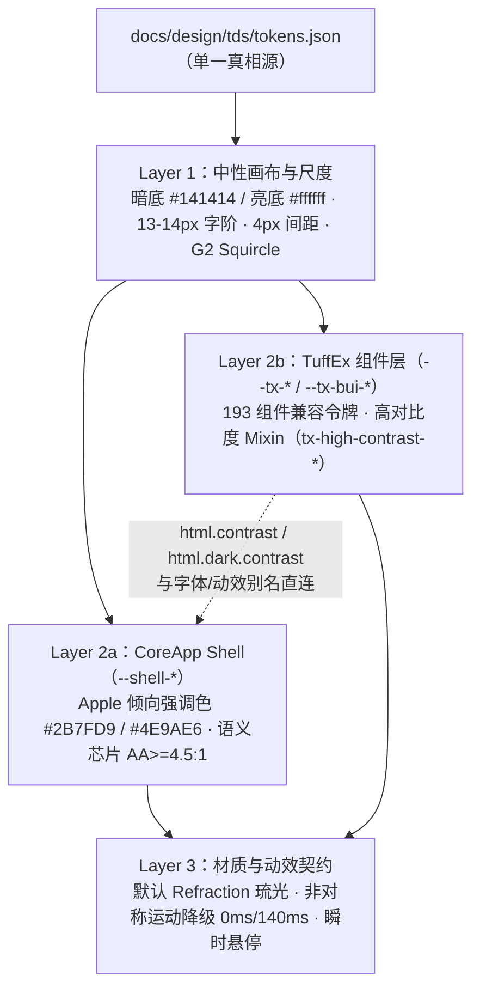

# TDS（Tuff Design System）架构与收敛索引

> 更新时间：2026-11-25
> 定位：Tuff 桌面端（CoreApp）、Nexus 站点、TuffEx 组件库与 AIUI（OpenUI）共享的设计令牌单一真相源与核心原语收敛索引。

---

## 1. 目录与权威文件映射

| 文件 | 角色 | 机器校验 |
| --- | --- | --- |
| [tokens.json](./tokens.json) | **单一真相源（SoT）**：四套主题色板、字阶、圆角、间距、阴影、动效、Refraction 材质参数、`--shell-*` ↔ `--tx-*` 收敛映射与实测对比度契约 | `shell-tokens.contract.test.ts` |
| [core-primitives.md](./core-primitives.md) | **36 个正交核心原语子集**、特化升级对照表与人类/LLM 共享的紧凑 Schema 约束 | `shell-tokens.contract.test.ts` 校验 36 个模块目录存在性 |
| `apps/core-app/src/renderer/src/styles/shell-tokens.scss` | CoreApp 壳层 CSS 变量落点（`:root`、`.dark`、`html.contrast`、`html.dark.contrast`） | 与 `tokens.json` 双向同步断言 |
| `apps/core-app/src/renderer/src/styles/shell-tokens.contract.test.ts` | 令牌同步 + WCAG 2.1 相对亮度 / Alpha 合成对比度 + Refraction 默认值契约测试 | `vitest`（纯 Node，零重依赖） |
| `packages/tuffex/packages/components/style/variables.scss` | TuffEx 全量 `--tx-*` 令牌与两套高对比度 Mixin（M0 只读审计，不破坏 193 个存量组件模块） | `audit:colors`、`dark-fill-tints.test.ts`、`dark-semantic-tokens.test.ts` |
| `packages/tuffex/packages/components/style/bui-tokens.scss` | AI 套件 `--tx-bui-*` 中性暗灰令牌层 | `bui-dark-neutral-ramp.test.ts` |

设计哲学与上游工程规范：
- [TuffEx 设计规则](../../engineering/specs/frontend/tuffex-design-rules.md)
- [前端组件开发规范](../../engineering/specs/frontend/component-guidelines.md)
- [设计概念与工程哲学（33 章全景）](../concepts/README.md)

---

## 2. 三层令牌架构



### 2.1 `--shell-*` 与 `--tx-*` 的收敛策略（稳健串联推进）

当前仓库存在三套并存的 CSS 变量命名空间，M0 阶段以**零破坏性收敛**为原则，先统一真相源、补齐桥接别名并锁定契约，再按里程碑演进：

| 维度 | `--shell-*`（CoreApp） | `--tx-*`（TuffEx） | `--tx-bui-*`（AI 套件） | M0 收敛状态 |
| --- | --- | --- | --- | --- |
| 亮/暗画布基底 | `#ffffff` / `#141414` | `#ffffff` / `#141414` | `#fafafb` / `#181818` | **已对齐**：暗底统一 `#141414` 中性深灰（防 OLED 拖尾、保留阴影深度） |
| 字体族与字重补偿 | `--shell-font-sans` / `--shell-font-mono` / `--shell-font-weight-*` | `--tx-font-family` / `--tx-font-mono` / `--tx-font-weight-*` | `--tx-bui-font-mono` | **已桥接**：`shell-tokens.scss` 直接别名至 `--tx-*`，修复 10 处 `--shell-font-mono` 悬空回退 |
| 动效与焦点环 | `--shell-ease-out` / `--shell-focus-ring` | `--tx-ease-out-strong` / `--tx-focus-ring-color` | — | **已桥接**：共享 `cubic-bezier(0.23, 1, 0.32, 1)` |
| 高对比度无障碍模式 | `html.contrast` / `html.dark.contrast` | `tx-high-contrast-light` / `tx-high-contrast-dark` | 不覆盖（已知边界） | **已收口并修复缺陷**：所有 5 个语义色（含 `primary-soft`）统一映射 `--tx-color-*` 与 `-light-9` |
| 主强调色 | `#2b7fd9`（亮）/ `#4e9ae6`（暗） | `#409eff`（Element 传承） | `#0285ff` / `#3d9aff` | **有意分歧，登记追踪**：M0 保持视觉稳定，不强行改动 193 个存量 TuffEx 组件；后续按 M2 节奏统一评估 |

> **M0 审计记录（`html.dark.contrast` 缺陷修复）**：在建立自动化 WCAG 对比度契约测试时发现，`shell-tokens.scss` 原 `html.dark.contrast` 块的 `--shell-primary-soft` 指向了 `var(--tx-color-primary-dark-2)`（在暗色高对比 Mixin 中该值为浅蓝 `#b8ddff`），导致 `--shell-primary`（`#7cc4ff`）与 `--shell-text-primary`（`#ffffff`）在其上的对比度跌至 **1.32:1 / 1.39:1**。现已按 `component-guidelines.md` 规范统一修正为 `var(--tx-color-primary-light-9)`（`#102536`），对比度提升至 **8.36:1 / 15.67:1**（AAA）。

---

## 3. WCAG 2.1 对比度基线（实测并由单测锁定）

所有芯片语义色均按真实渲染面测量：**前景语义色 vs 对应 `-soft` 叠加在 `--shell-bg` 后的合成色**（非裸背景）。

| 配对 | Light (`:root`) | Dark (`.dark`) | HC Light (`html.contrast`) | HC Dark (`html.dark.contrast`) | 门禁下限 |
| --- | --- | --- | --- | --- | --- |
| `text-primary` / `bg` | 16.83:1 | 16.92:1 | 17.74:1 | 18.42:1 | ≥ 4.5（HC ≥ 7.0） |
| `text-regular` / `bg` | 9.12:1 | 12.11:1 | 14.68:1 | 16.74:1 | ≥ 4.5（HC ≥ 7.0） |
| `text-secondary` / `bg` | 5.07:1 | 8.33:1 | 10.31:1 | 12.50:1 | ≥ 4.5（HC ≥ 7.0） |
| `on-primary` / `primary` | 4.09:1（UI/大字 AA） | 5.24:1（`#0a2540`） | 5.98:1 | 8.28:1（`#0a2540`） | 亮 ≥ 3.0 / 暗 ≥ 4.5 / HC暗 ≥ 7.0 |
| `primary` / `primary-soft` | 3.61:1（UI 强调态） | 5.05:1 | 5.48:1 | 8.36:1 | 暗/HC ≥ 4.5（HC暗 ≥ 7.0） |
| `success` / `success-soft` | 4.81:1 | 5.70:1 | 5.93:1 | 12.41:1 | ≥ 4.5（HC暗 ≥ 7.0） |
| `warning` / `warning-soft` | 4.72:1 | 6.35:1 | 4.60:1 | 11.51:1 | ≥ 4.5（HC暗 ≥ 7.0） |
| `danger` / `danger-soft` | 4.82:1 | 4.53:1 | 5.38:1 | 9.53:1 | ≥ 4.5（HC暗 ≥ 7.0） |
| `info` / `info-soft` | 4.60:1 | 5.15:1 | 6.32:1 | 11.79:1 | ≥ 4.5（HC暗 ≥ 7.0） |

---

## 4. 材质与排版硬性准则

1. **默认表面材质为 `refraction`**：`TxBaseSurface` 默认 `mode="refraction"`、`refractionRenderer="css"`（避免无谓的 SVG 滤镜开销；需要色散位移时显式开启 `refractionRenderer="svg"`，`refractionGlassOpacity=0.3`）。切换到 `flat` / `plain` / `mask` / `blur` / `glass` / `acrylic` / `mica` **必须经过用户手动明确确认**。
2. **运动降级非对称时钟**：`autoDetect` 或 `moving` 触发时 **0ms** 立刻分层退让（遮盖 0.55、参数退到 0.28、滤镜 140ms 淡出），静止 **140ms** 迟滞后分阶段恢复（参数 182ms、遮盖延迟 60ms 释放 228ms、描边延迟 60ms 淡回 220ms）；省电（电量 ≤ 20%）或帧预算 `reduced` 降为 `blur`，`minimal` 与高对比度模式统一降为 `flat`。
3. **13–14px 生产力字阶**：正文 13px、控件值 14px、辅助 12px、微标签 11px；行内等宽代码缩至 `0.9em`；暗色强调字重由 `tx-dark-weight` 下调 40（500→460、600→560、700→660），静态字体安全回落到原字面。
4. **零自定义覆盖样式**：业务页面只消费 `--shell-*` / `--tx-*` 与 TDS Core 36 原语，不写局部 CSS hack。

---

## 5. 验证命令

```bash
# 1. CoreApp 令牌同步 + WCAG 2.1 AA 对比度 + Core 36 存在性契约测试
nice -n 10 pnpm -C apps/core-app vitest run src/renderer/src/styles/shell-tokens.contract.test.ts

# 2. TuffEx 令牌只读基线审计
nice -n 10 pnpm -C packages/tuffex run audit:colors
nice -n 10 pnpm -C packages/tuffex vitest run packages/components/src/__tests__/dark-fill-tints.test.ts
```
