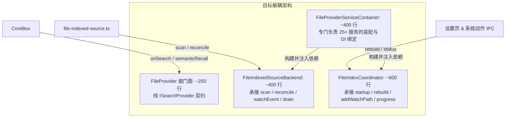

# FileProvider 巨石架构深拆分析与演进方案

> 日期：2026-10-18
> 状态同步：2026-11-17（`HEAD 37b3fc7e9`）
> 关联任务：[TODO-BACKLOG-LONG-TERM.md](../../plan-prd/TODO-BACKLOG-LONG-TERM.md#a-架构与质量债务)（SRP Wave C）
> 涉及文件：`apps/core-app/src/main/modules/box-tool/addon/files/file-provider.ts`（10-18 基线 4,073 行 → **当前 3,195 原始行 / 2,790 代码行**，棘轮上限 `2,790`）
> 关联报告：[`search-crossplatform-audit.md`](./search-crossplatform-audit.md)、[`file-search-integration-2.5.1-2026-10-11.md`](./file-search-integration-2.5.1-2026-10-11.md)

---

## 一、背景与问题核查

在 SRP Wave C 治理中，`file-provider.ts` 在 2026-10-18 基线时代码量达 **4,073 行**；截至 2026-11-17（`HEAD 37b3fc7e9`），经过多轮子服务抽离已降至 **3,195 原始行 / 2,790 代码行**。经工程核查，**已抽离出 25+ 独立子服务与专用 Worker 线程**，包括：

1. **文件监听**：`FileProviderWatchService`、`file-watch-subtree-service.ts`、`FileProviderWatchSubtreeReconcileService`；
2. **内容提取与策略**：`FileProviderContentIndexPolicyService`、`FileProviderContentCapacityService`、`FileProviderIndexSchedulerService`、`FileProviderIndexRuntimeService`、`FileProviderEnrichmentResumeService`、`FileIndexWorkerClient`（Worker 线程）；
3. **历史迁移、持久路由与引导（10-20 ~ 10-31 新增抽离）**：`FileProviderBootPassService`、`FileProviderPathNormalizationService`、`FileProviderKeywordBackfillService`、`FileProviderIndexRowStore`（`indexRowStore`）、`FileProviderSubtreePersistService`、`FileProviderOverlongContentCleanupService`、`FileProviderEmbeddingBlobMigrationService`；
4. **向量化与电池状态**：`EmbeddingService`、`FileProviderEmbeddingIndexService`、`deviceIdleService`（全局服务）。

### 为什么抽离后仍达 3,195 原始行（2,790 代码行）？

代码实况与方法分布证明：**“子服务与 Step 2 历史迁移已经抽离，但宿主类仍兼任核心角色，且把装配胶水、剩余分库分支和控制面 IPC 留在了 `FileProvider`”**：

```
file-provider.ts (2026-11-17 实测: 3,195 原始行 / 2,790 代码行；10-18 基线曾为 4,073 行)
├── 1. 构造函数依赖注入样板（第 505-1092 行，约 588 行）— [Step 1 未落地]
│   └── 现场实例化 25+ 个子服务并内联编写匿名闭包回调。
├── 2. 扫描、初始化与落盘协调管线 — [Step 4 未落地]
│   ├── _initialize（第 2942 行）、rebuildIndex（第 2386 行）、startIndexing（第 1772 行）
│   └── persistAndPublishFullScanBatch（第 1344 行）等协调与增量落盘逻辑仍在宿主。
├── 3. 历史版本迁移与 Backfill — [Step 2 已于 10-20 落地]
│   └── loadPathNormalizationRowsPage、rewriteFilePathToNormalizedForm、emitKeywordBackfillRows 已从 file-provider.ts 彻底移除，下沉至 boot-pass-service / path-normalization-service / keyword-backfill-service。
├── 4. 分库双拓扑条件分支 — [Step 3 部分落地]
│   └── indexRowStore 与 subtreePersistService 已抽离，但文件内仍余 8 处 isSearchSplitEnabledNow() 调用（含定义共 9 处）及 6 处 databaseManager.isSearchSplitEnabled() 分支。
└── 5. 控制面 IPC 事件中继与流式广播 — [Step 4 未落地]
    └── addWatchPath（第 2500 行）、registerProgressStream（第 2596 行）、状态与证据导出。
```

---

## 二、角色解耦模型（4 角色分离）

`FileProvider` 当前揉杂了 4 种不同维度的系统角色，演进目标是将门面缩减至 **300 行以内**：



| 角色 | 目标单元 | 承担职责与方法 | 预估行数 |
|---|---|---|---|
| **搜索门面** | `FileProvider` | `onSearch`、`onExecute`、`semanticRecall`、`hasSearchFilters`、`resolvePreviewResourcePath`、`resolveIndexedActionPath` | ~250 行 |
| **索引源后端** | `FileIndexedSourceBackend` | 专职对接 `file-indexed-source.ts`：`scan`、`reconcile`、`handleWatchEvent`、`drainMutations`、`resetRuntimeState` | ~400 行 |
| **引擎协调器** | `FileIndexCoordinator` | 控制面调度：`startIndexing`、`rebuildIndex`、`addWatchPath`、`registerProgressStream`、`getContentIndexSettings` | ~600 行 |
| **依赖装配工厂** | `FileProviderServiceContainer` | 25+ 个子服务实例化与参数组装，收敛 560+ 行 constructor 匿名闭包 | ~400 行 |

---

## 三、平滑优化演进路线

采用增量重构，每一步可独立提交、独立运行测试，禁止破坏既有并发与持久化保证：

### Step 1：抽离依赖装配工厂 — `[ ] 未落地`（收益：立即减少 ~588 行，风险：零）
- **操作**：创建 `file-provider-service-container.ts`，将 `FileProvider` constructor（当前位于第 505–1092 行，共 588 行）中实例化子服务及匿名配置对象的代码移入 `createFileProviderServices(deps)`。
- **效果**：`file-provider.ts` 从当前 **3,195 原始行 / 2,790 代码行** 降至 ~2,600 原始行。纯代码位置搬移，不改任何调用链与状态机，测试 100% 通过。

### Step 2：历史迁移任务闭环下沉 — `[x] 已落地`（2026-10-20 合入主线）
- **实况**：`loadPathNormalizationRowsPage`、`rewriteFilePathToNormalizedForm`、`emitKeywordBackfillRows` 已从 `file-provider.ts` 彻底移除（零残留），迁入 `services/file-provider-boot-pass-service.ts`、`services/file-provider-path-normalization-service.ts` 与 `services/file-provider-keyword-backfill-service.ts`。
- **效果**：`FileProvider` 不再充当迁移脚本执行器，仅保留调度触发入口；原文件体积已从 4,073 行降至 3,195 原始行。

### Step 3：分库双拓扑持久化收敛 — `[~] 部分落地`（剩余 ~14 处 split 分支待收口）
- **实况**：`FileProviderIndexRowStore`（`indexRowStore`）与 `FileProviderSubtreePersistService`（`subtreePersistService`）已抽离，但 `file-provider.ts` 内仍残余 **8 处** `isSearchSplitEnabledNow()` 调用（加定义共 9 处）及 **6 处**直接 `databaseManager.isSearchSplitEnabled()` 条件分支。
- **操作**：在 `search-split:app-evidence` 3 阶段实跑验收通过后，抽象轻量级 `FilePersistenceRouter`，把上述条件分支收敛为统一调度器。

### Step 4：彻底剥离搜索 Provider 与索引协调引擎 — `[ ] 未落地`（建议与 3.0 Phase 1 `utilityProcess` 及 `F1–F3` 合并）
- **操作**：
  1. 结合 `docs/plan-prd/03-features/search/FILE-AND-APP-INDEX-ROADMAP.md` §3.F 先清理 `F1`（纯记录映射 ~50 行）、`F2`（`_initialize` 第 2942 行）与 `F3`（47 行死公开成员及重复 yield/sleep 闭包）；
  2. 将全量扫描批处理落盘（`persistAndPublishFullScanBatch` 第 1344 行）、`startIndexing`（第 1772 行）、`rebuildIndex`（第 2386 行）与控制面 IPC（`addWatchPath` 第 2500 行、`registerProgressStream` 第 2596 行）按 4 角色拆分移入 `FileIndexPipelineCoordinator` / `FileIndexCoordinator`；
  3. 让 `file-indexed-source.ts` 直接挂接 `FileIndexedSourceBackend`，解除对 `FileProvider` 宿主对象的直接引用，`FileProvider` 蜕变为纯粹的只读搜索 Provider（同步对齐 3.0 Phase 1 内核进程边界，避免改两次接口）。

---

## 四、重构必须遵守的三条工程不变量（Invariants）

在执行上述分阶段优化时，必须死守以下底线：

1. **AIMD 批调度与退避契约不变**：`upsertBatchScheduler` 的 10 条上限、慢批次 ≥250ms backoff、以及 `waitForIdle` 机制必须原封不动保留，不能因分层解耦破坏写入让步。
2. **`mutationLease` 取消屏障不变**：超时或取消时调用 `markContentEnrichmentPending` 标记待恢复行的机制必须严格保留，杜绝任务中断时的数据静默丢失。
3. **主库与搜索库 ID 防碰撞隔离不变**：在 Split DB 模式下，搜索库持久化必须只消费搜索库的自增 row ID，严防主库 ID 穿透导致的错位更新。
