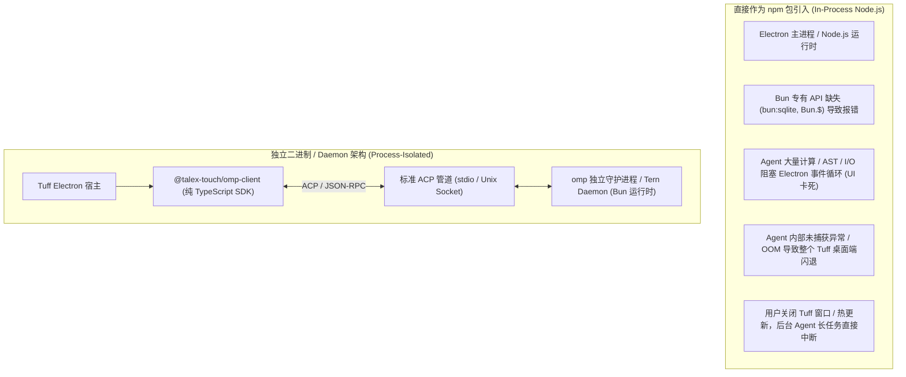
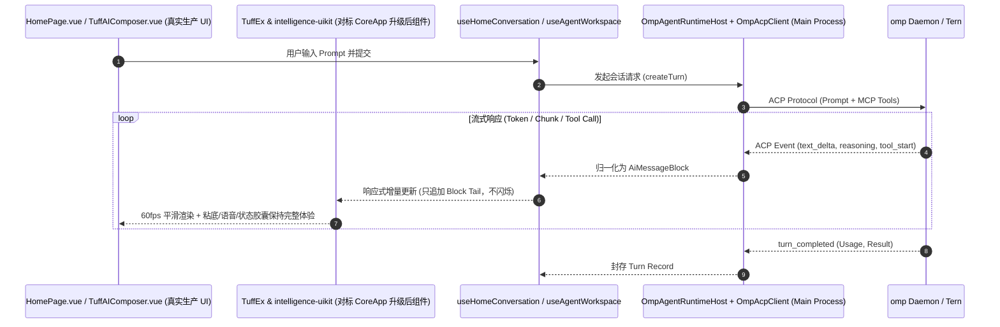

# omp 运行时与 Tern 预留协议 GUI 集成技术调研报告

> 日期：2026-11-01
> 状态同步：2026-11-17（`HEAD 37b3fc7e9`）
> 背景：评估将 Tuff 现存的内置 `pi`（`@earendil-works/pi-agent-core`）升级为 `omp`，并复用 Tern 预留协议与组件实现 GUI 的可行性；同时对“omp 是否可以像 npm 包一样直接在进程内依赖”及“当前 Intelligence UI 现状与演进路径”进行深度论证。
> **2026-11-17 实况校正**：`HomePage.vue` 已瘦身至 **1,941 行**并部分接入 `@talex-touch/intelligence-uikit`；`OmpAcpClient` 与 `OmpAgentRuntimeHost` 代码与单测已落地但尚未接入 `ai-cli-orchestrator.ts`；UI 收敛路线已明确修正为“先基于 CoreApp 真实生产 UI 升级 TuffEx / UIKit 组件，禁止将生产 UI 降级迁向占位壳组件”。

---

## 1. 核心结论与技术选型定界

| 议题 | 结论 | 推荐程度 | 核心判断与工程边界 |
|---|---|---|---|
| **内置 `pi` 切换为 `omp`** | ✅ 极高可行性 | **强烈推荐** | **架构代际升级**。当前内置的 `@earendil-works/pi-agent-core`（`0.85.1`）仍通过 `PiAgentRuntimeHost` 独占运行于 `ai-cli-orchestrator.ts:530`；已落地的 `OmpAcpClient` / `OmpAgentRuntimeHost` 接线后可由外部 `omp` 原生获得 Subagent 并发、ACP（Agent Client Protocol）、`out://` 流式输出、Prompt Cache 与动态权限审批能力（且须遵守 `AGENTS.md` `THIRD_PARTY_CLIS` / `profile:cli:*` 调度边界）。 |
| **omp 作为普通 npm 包进程内引用 (`import`)** | ❌ 架构不可行 | **不推荐直接 In-Process** | **运行时断层与稳定性灾难**。omp 深度依赖 **Bun 专有运行时**（`Bun.$`, `bun:sqlite`, Bun I/O 等），而 Electron 是 Node.js 宿主；且 Agent 在进程内执行任意 Bash/Python、复杂 AST 与长上下文会导致 Electron 事件循环严重卡死（Lag）甚至 OOM 闪退。**正确解法是采用类似 esbuild/prisma 的“npm SDK 包装器 + 独立二进制/守护进程”分发模式**。 |
| **复用 Tern 预留协议实现 GUI** | ✅ 高可行性 | **推荐（协议层复用）**<br>❌ 不推荐（直接窗口强嵌） | **采纳其协议规范，保持原生 UI**。Tern 内置的 Carly 会话命令（`carly ask/stream/step/tool`）与 ACP 提供了清晰的 AI 交互流规范。建议在协议层对接，而不是把 Tern 基于 WGPU/Rust/Stencil 渲染的终端原生窗口强嵌到 Electron 视图中（视觉与交互风格割裂）。 |
| **当前 Intelligence UI 演进** | ⚠️ 先升级库，禁迁占位壳 | **先强组件库、再减主页面** | **2026-11-17 实况与纠偏**：`HomePage.vue` 已由 4,433 行降至 **1,941 行**（`HomeMessageRow.vue` 已用 `TxAiAssistantTurn`，主进程已用 `openui-prompt`），流容器与输入区仍由 `TxConversationStream` + `TuffAIComposer.vue`（390 行 + `composer/*`）承担。**严禁**把 CoreApp 真实 UI 迁向当前尚为占位壳的 `TxAiConversation`（120 行）/ `TxAiComposer`（58 行）/ `TxPromptBar`；必须**先以 CoreApp 现存真实 UI 为参照升级 TuffEx 与 `intelligence-uikit` 组件**，对齐并优于现实现后再考虑上层容器瘦身。 |

---

## 2. 深度剖析：omp 为什么不能直接像一个普通的 npm 包？

用户直觉：“为什么不能直接在 `package.json` 加一行 `"omp": "^18.14.2"`，然后在 Node.js 里 `import { Omp } from 'omp'` 直接 `new` 出来？”

从软件工程与系统架构角度，这里存在四道无法回避的技术鸿沟：



### 2.1 运行时断层（Bun Runtime vs Node.js / Electron）
- **Bun 深度绑定**：`omp` 是基于 **Bun** 构建的单文件编译二进制（`bun build --compile`），其内部重度使用了 Bun 独特的原语：`Bun.$` 高性能 Shell 流、`bun:sqlite` 快速本地存储、Bun 零拷贝网络 I/O、以及 `eval` 工具中内置的 Bun 引擎上下文。
- **Node.js 无法直接兼容**：Electron 主进程运行在标准的 Node.js (V8) 环境中。Node.js 无法解析 `bun:*` 模块。如果要把 omp 改造成纯 Node.js 的 npm 包，必须把底层所有高性能 I/O 全量改写或引入笨重的 Polyfill，彻底脱离 upstream 的更新节奏。

### 2.2 事件循环与性能隔离（Event Loop Lag）
- 现代 Coding Agent 不是简单的 HTTP 请求转发器。在一次交互中，omp 会执行：并行检索工作区、计算 Token、解析多层 Tool 结构、运行 subagent 依赖图、管理 PTY 虚拟终端。
- 如果将这些逻辑放在 Electron 主进程（甚至单线程的 `utilityProcess`）内存空间中：
  - **严重阻塞主线程**：大量密集计算和本地 I/O 会直接导致主进程与渲染进程之间的 IPC 响应延迟飙升（产生 1~2s 的 Event Loop Lag），用户最直观的感受就是“打字卡顿”、“CoreBox 呼出延迟”。
  - **内存峰值不可控**：Agent 在处理长上下文（100K~200K tokens）和执行分析任务时，堆内存常驻几百 MB 上 GB，极易触发 V8 堆上限导致应用崩溃。

### 2.3 故障隔离与崩溃边界（Crash Isolation）
- Agent 必须具有执行系统操作、动态加载原生插件、运行代码的能力。在遭遇段错误（SIGSEGV）、内存溢出（OOM）或原生动态链接库冲突时：
  - **In-process 模式**：整个 Tuff 桌面应用直接消失闪退，用户未保存的工作全部丢失。
  - **独立进程模式**：仅 Agent 子进程退出，Tuff 宿主可以通过进程监控捕获并提示“Agent 异常退出，正在尝试断点恢复”。

### 2.4 任务生命周期独立性（Daemon vs Window Lifecycle）
- Agent 任务往往是长周期的（如代码审查、批量文件处理、异步测试运行，耗时可能达数分钟到数十分钟）。
- 如果作为 npm 包跑在 Electron 窗口绑定的生命周期中，用户切换窗口、关闭前端标签页或渲染层崩溃时，整个任务会被强行中断。
- 采用独立进程/守护进程（Daemon）模式，前端只是一个“观察视窗”，即使 Tuff 重启或前端页面重载，Agent 仍在后台稳定运行，重新打开界面即可重新 attach 到原会话。

### 2.5 业界成熟实践：以 npm 形式分发的“包装器 SDK”模式
**结论并不是“放弃 npm”，而是“以正确的方式制作 npm 包”。**  
正如 `esbuild`、`prisma`、`turbo`、`mise` 的设计：
1. **分发层**：发布 `@talex-touch/omp-client` npm 包，声明平台依赖包（如 `@omp/darwin-arm64`、`@omp/win32-x64`）负责携带各平台编译好的 omp 二进制。
2. **抽象层**：包内暴露纯 TypeScript 接口：
   ```ts
   import { OmpDaemonClient } from '@talex-touch/omp-client'

   const omp = new OmpDaemonClient({
     // 自动探测本地 Tern daemon.sock 或调起内置嵌入式二进制
     socketPath: process.env.TERN_DAEMON_SOCKET,
     autoSpawn: true
   })

   const session = await omp.createSession({ profile: 'tuff-desktop' })
   session.on('stream_chunk', (chunk) => { /* 投递给 UI */ })
   ```
这样在业务开发者的视角下，**它就是一个完整的 npm 包，既有强类型的调用体验，又享受了操作系统的物理进程隔离**。

---

## 3. Tern 预留协议与 GUI 集成可行性分析

### 3.1 Tern 协议现状
Tern（`/Applications/Tern.app`）是目前承载 omp 最深度的桌面终端与 AI 宿主。其源码和帮助手册暴露了非常完整的集成协议点：

1. **`carly` 系列会话驱动命令**：
   - 包含完整的交互生命周期：`carly open|new|ask|queue|stream|reply|fail`。
   - 包含清晰的工具状态机：`carly step run|ok|bad <label>`、`carly command run|ok|bad <line>`。
   - 包含多模态与语音能力：`carly voice connecting|listening|speaking|working|muted`。
2. **ACP（Agent Client Protocol）与 JSON-RPC 模式**：
   - `omp acp` 实现了标准的 Agent Client Protocol over stdio。
   - `omp --mode rpc-ui` 原生支持将流式文本、思考块（thinking）、工具审批请求以标准 JSON 结构对外发送。
3. **Control Socket (`tern ctl`)**：
   - 支持通过 Unix Domain Socket 注入控制指令、抓取界面渲染树 (`tree`)、获取状态 (`state`)、监控帧率性能 (`perf`)。

### 3.2 接入路径评估：协议桥接 vs. 界面嵌入

| 集成路线 | 方案说明 | 优点 | 缺点 | 评估 |
|---|---|---|---|---|
| **方案 A：原生窗口/网页嵌入**<br>*(WebContentsView 嵌 `tern web serve` 或 Native Window 容器)* | 利用 Tern 的 `web serve` 或窗口嵌入功能，直接把 Tern 的 UI 塞进 Tuff 窗口 | 开发工作量小，几乎零前端编码，直接复用 Tern 原生终端界面 | **体验灾难**。WGPU 绘制风格与 Tuff 的 UnoCSS/Vue3 设计语言格格不入；弹窗、字体缩放、主题切换极易冲突；失去了 Tuff 核心卡片化交互与精细动画能力 | ❌ 强烈不推荐 |
| **方案 B：ACP / Carly 协议桥接 + 基于 CoreApp 真实 UI 演进的自研组件**<br>*(推荐路径)* | Tuff 主进程实现 `OmpAcpClient` + `OmpAgentRuntimeHost`（已建待接 `ai-cli-orchestrator.ts`），前端先按 CoreApp 现存真实 UI 升级 TuffEx / `intelligence-uikit` 再逐步复用 | 视觉绝对统一，不丢失 CoreApp 现有精细动效与交互细节；完全解耦底层 Agent 实现；会话数据可与本机 Tern 互通 | 需补齐事件映射并先将 TuffEx / UIKit 升级到 CoreApp 真实 UI 水准 | ✅ **最佳架构** |

---

## 4. 目前的 Intelligence UI 现状与演进路径（2026-11-17 校正）

### 4.1 核心痛点与代码实况审计
1. **`HomePage.vue` 已瘦身至 1,941 行，但仍余重编排层**：
   - `HomePage.vue` 已从 4,433 行缩减为 **1,941 行**（`<script>` 957 行 + `<template>` 370 行 + `<style>` 612 行），抽离出了 `HomeMessageRow.vue`（322 行）、`TuffAIComposer.vue`（390 行）、`composer/*`（`ComposerChip`、`ComposerControl`、`ComposerMic`、`ComposerModelPill`、`ComposerSendIsland`、`ComposerToolbar`、`HomeContextMeter`、`HomeRunStatus`、`HomeVoiceDraft` 等）以及 15+ composables。
   - 但 `HomePage.vue` 仍保有 957 行脚本与 612 行 CSS（包含打开路由动效、发送轨迹 `useSendChoreography`、审批/门禁/分支状态协调），局部变更仍具一定耦合面。
2. **`@talex-touch/intelligence-uikit` 已部分接入，但通用 AI 壳组件当前只是占位实现**：
   - `HomeMessageRow.vue` 已正式接入 `@talex-touch/intelligence-uikit` 的 `TxAiAssistantTurn`（与 `TxAttachmentTray`、`TxMessageActions`、`TxVoiceClip` 配合），主进程 `home-conversation-injection.ts` 已使用 `@talex-touch/intelligence-uikit/openui-prompt` 的 `openUIPrompt`。
   - **关键事实纠偏**：CoreApp 的消息流视口当前使用的是 `@talex-touch/tuffex/conversation-stream` 的 `TxConversationStream`，输入区使用的是 CoreApp 自研高完成度的 `TuffAIComposer.vue`（390 行）+ `composer/*`。与之对比，`packages/intelligence-uikit` 内的 `TxAiConversation.vue`（120 行，无虚拟滚动/触顶加载）与 `TxAiComposer.vue`（58 行，仅透传 `TxChatComposer`），以及 `@talex-touch/tuffex` 现有的 `TxPromptBar` / `TxChatComposer` / `TxChatList` / `TxChatMessage`，目前仍停留在简化占位壳阶段。
3. **关键设计指令：先以 CoreApp 真实 UI 升级组件库，绝不反向迁移至占位壳**：
   - **严禁**按原 11-01 初稿思路把 `HomePage.vue` / `TuffAIComposer.vue` 直接替换迁往占位 `TxAiConversation` / `TxAiComposer` / `TxPromptBar`。
   - 必须**反向演进**：以 CoreApp 现存真实生产的 `HomePage.vue`、`HomeMessageRow.vue`、`TuffAIComposer.vue` 与 `composer/*` 为视觉、结构、状态机与动效参考基准，优先升级 `@talex-touch/tuffex` 的 AI conversation / prompt bar / chat 组件与 `@talex-touch/intelligence-uikit`；只有当组件库自身达到同等以上工程与体验完成度后，才考虑在 CoreApp 上层进行无回归复用。

### 4.2 演进重构建议（2026-11-17 校正版四阶段收敛路线）



1. **第一阶段：基于 CoreApp 真实 UI 升级 `@talex-touch/tuffex` 与 `@talex-touch/intelligence-uikit`（先强组件库）**
   - **TuffEx AI 对话与输入组件重构**：对照 `HomePage.vue`、`HomeMessageRow.vue`、`TuffAIComposer.vue` 与 `composer/*`，升级 `TxPromptBar`、`TxChatComposer`（毛玻璃/折射表面、focus beam / voice glow 状态、顶部可扩展附件/上下文托盘、可组合 chip/model pill/context meter/run status/mic+语音草稿、发送/排队/停止胶囊岛、Enter/Shift+Enter/IME 组合输入守卫与 `@`/`/` token 菜单）以及 `TxConversationStream`、`TxChatList`、`TxChatMessage`（粘底弹簧、流式增高防抖、回底悬浮胶囊、触顶加载、非闪烁流式消息渲染）。
   - **UIKit 同步对齐**：基于升级后的 TuffEx 原语重构 `@talex-touch/intelligence-uikit`（`TxAiConversation`、`TxAiComposer`、`TxAiAssistantTurn` 等），确保 `TxAiStreamText` / Markdown 增量更新不重挂载整棵 DOM 树，且能力和精细度匹配 CoreApp 生产水准。
2. **第二阶段：`HomePage.vue` 无回归渐进瘦身**
   - **前置条件**：仅在第一阶段 TuffEx 与 `intelligence-uikit` 已验证达到与 CoreApp 真实 UI 齐平或更优的视觉、动效与交互体验后，才启动上层容器收敛。
   - **目标**：在不替换或降级真实功能的前提下，将 `HomePage.vue` 剩余的 957 行脚本与 612 行样式进一步拆入专用 composables 与升级后的组件边界（目标 ≤800 行）。
3. **第三阶段：`OmpAgentRuntimeHost` 生产接线与 MCP 工具网关暴露**
   - **代码现状**：`OmpAcpClient`（`packages/tuff-intelligence/src/omp/omp-acp-client.ts`）与 `OmpAgentRuntimeHost`（`apps/core-app/src/main/modules/ai/omp/omp-agent-runtime-host.ts`）及单测已构建完成；但 `apps/core-app/src/main/modules/ai/ai-cli-orchestrator.ts`（第 530 行）生产路径仍独占实例化 `PiAgentRuntimeHost`（`@earendil-works/pi-agent-core@0.85.1`），`pi-cli-provider.ts` 中 `omp` 仍只运行 `omp --print --mode json` 单次子进程。
   - **落地方式**：在 `ai-cli-orchestrator.ts` 接入 `OmpAgentRuntimeHost` 并以标准 MCP 暴露工具网关，同时严守 `AGENTS.md` 的 **调度器决定执行器** 不变量——第三方 CLI（`codex`、`claude`、`omp`）仅在其对应调度器配置（`profile:cli:{codex,claude,omp}`）下启动子进程，其他调度器或未命名调度器继续经 `cli-config-provider.ts` 复用配置端点（`codex-config`、`claude-config`、`omp-config`）。
4. **第四阶段：Tern Daemon 互通**
   - 允许检测本地是否存在运行中的 Tern Daemon（`daemon.sock`），提供“无缝漫游”选项，实现终端 Agent 与桌面 GUI 的会话与状态共享。

---

## 5. 实施底线与工程禁区

1. **禁止在 Node.js 主进程中直接 `require`/`import` omp 的 Bun 内部代码**，必须通过物理隔离的子进程或 Unix Socket 通信。
2. **禁止在 UI 组件内部耦合任何网络请求、Token 扣减与平台持久化逻辑**，`intelligence-uikit` 必须严格保持无副作用的 Pure UI 定位。
3. **禁止强嵌 Tern 的原生窗口**，必须守住 Tuff 精致细腻的桌面交互与设计规范边界。
4. **禁止将 CoreApp 现有真实 AI UI 降级迁入占位壳组件**：必须先基于 CoreApp 现存真实 UI（`HomePage.vue`、`TuffAIComposer.vue`、`composer/*`、`HomeMessageRow.vue`）升级 `@talex-touch/tuffex` 与 `@talex-touch/intelligence-uikit`，达到完整视觉、动效与交互对等前不得替换生产 UI。
5. **严守 `AGENTS.md` 调度器-执行器不变量**：仅 `profile:cli:*` 可拉起对应第三方 CLI 二进制进程，Tuff 内置调度器或其他配置不得经由 `metadata.profileId` 之外的开关或回退路径派生第三方 CLI。
