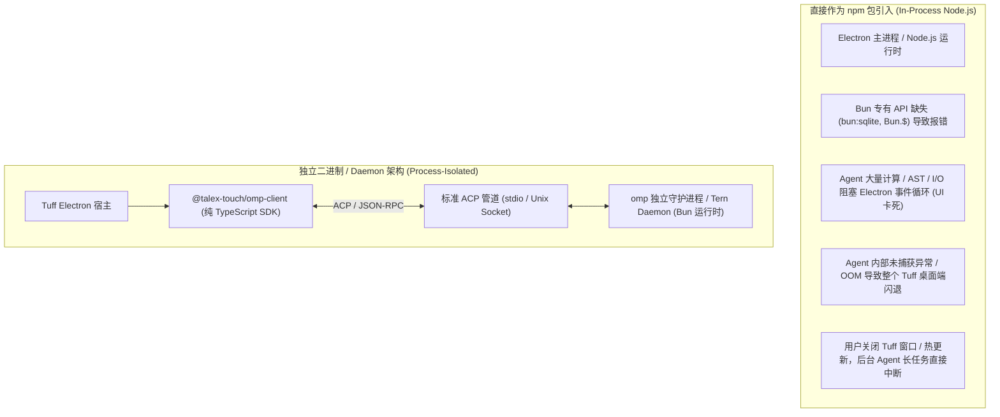
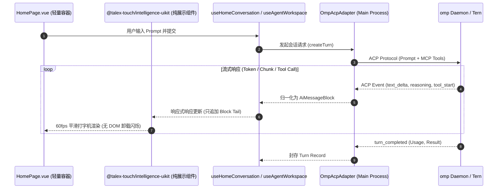

# omp 运行时与 Tern 预留协议 GUI 集成技术调研报告

> 日期：2026-11-01  
> 状态：调研完成；作为 AI 架构升级与 UI 解耦的底层技术选型参考，未进入正式编码阶段。  
> 背景：评估将 Tuff 现存的内置 `pi`（`@earendil-works/pi-agent-core`）升级为 `omp`，并复用 Tern 预留协议与组件实现 GUI 的可行性；同时对“omp 是否可以像 npm 包一样直接在进程内依赖”及“当前 Intelligence UI 现状与演进路径”进行深度论证。

---

## 1. 核心结论与技术选型定界

| 议题 | 结论 | 推荐程度 | 核心判断与工程边界 |
|---|---|---|---|
| **内置 `pi` 切换为 `omp`** | ✅ 极高可行性 | **强烈推荐** | **架构代际升级**。当前内置的 `@earendil-works/pi-agent-core` 是 omp 早期的历史核心，升级为外部解耦的 `omp` 可原生获得 Subagent 并发、ACP（Agent Client Protocol）、`out://` 流式输出、Prompt Cache 与完备的动态权限审批能力，大幅卸下主进程打包与维护负担。 |
| **omp 作为普通 npm 包进程内引用 (`import`)** | ❌ 架构不可行 | **不推荐直接 In-Process** | **运行时断层与稳定性灾难**。omp 深度依赖 **Bun 专有运行时**（`Bun.$`, `bun:sqlite`, Bun I/O 等），而 Electron 是 Node.js 宿主；且 Agent 在进程内执行任意 Bash/Python、复杂 AST 与长上下文会导致 Electron 事件循环严重卡死（Lag）甚至 OOM 闪退。**正确解法是采用类似 esbuild/prisma 的“npm SDK 包装器 + 独立二进制/守护进程”分发模式**。 |
| **复用 Tern 预留协议实现 GUI** | ✅ 高可行性 | **推荐（协议层复用）**<br>❌ 不推荐（直接窗口强嵌） | **采纳其协议规范，保持原生 UI**。Tern 内置的 Carly 会话命令（`carly ask/stream/step/tool`）与 ACP 提供了清晰的 AI 交互流规范。建议在协议层对接，而不是把 Tern 基于 WGPU/Rust/Stencil 渲染的终端原生窗口强嵌到 Electron 视图中（视觉与交互风格割裂）。 |
| **当前 Intelligence UI 演进** | ⚠️ 急需治理与收敛 | **必须重构** | **巨石未拆 + 新包空转**。`HomePage.vue`（4,433 行）深度耦合了状态机、动效编排与散装组件拼装，且流式渲染存在全量重新挂载闪烁缺陷；而已建好的 `packages/intelligence-uikit` 尚未实际接入主程序。必须将 UI 收敛为基于 Block 的纯展示组件库。 |

---

## 2. 深度剖析：omp 为什么不能直接像一个普通的 npm 包？

用户直觉：“为什么不能直接在 `package.json` 加一行 `"omp": "^18.14.2"`，然后在 Node.js 里 `import { Omp } from 'omp'` 直接 `new` 出来？”

从软件工程与系统架构角度，这里存在四道无法回避的技术鸿沟：



### 2.1 运行时断层（Bun Runtime vs Node.js / Electron）
- **Bun 深度绑定**：`omp` 是基于 **Bun** 构建的单文件编译二进制（`bun build --compile`），其内部重度使用了 Bun 独特的原语：`Bun.$` 高性能 Shell 流、`bun:sqlite` 快速本地存储、Bun 零拷贝网络 I/O、以及 `eval` 工具中内置的 Bun 引擎上下文。
- **Node.js 无法直接兼容**：Electron 主进程运行在标准的 Node.js (V8) 环境中。Node.js 无法解析 `bun:*` 模块。如果要把 omp 改造成纯 Node.js 的 npm 包，必须把底层所有高性能 I/O 全量改写或引入笨重的 Polyfill，彻底脱离 upstream 的更新节奏。

### 2.2 事件循环与性能隔离（Event Loop Lag）
- 现代 Coding Agent 不是简单的 HTTP 请求转发器。在一次交互中，omp 会执行：并行检索工作区、计算 Token、解析多层 Tool 结构、运行 subagent 依赖图、管理 PTY 虚拟终端。
- 如果将这些逻辑放在 Electron 主进程（甚至单线程的 `utilityProcess`）内存空间中：
  - **严重阻塞主线程**：大量密集计算和本地 I/O 会直接导致主进程与渲染进程之间的 IPC 响应延迟飙升（产生 1~2s 的 Event Loop Lag），用户最直观的感受就是“打字卡顿”、“CoreBox 呼出延迟”。
  - **内存峰值不可控**：Agent 在处理长上下文（100K~200K tokens）和执行分析任务时，堆内存常驻几百 MB 上 GB，极易触发 V8 堆上限导致应用崩溃。

### 2.3 故障隔离与崩溃边界（Crash Isolation）
- Agent 必须具有执行系统操作、动态加载原生插件、运行代码的能力。在遭遇段错误（SIGSEGV）、内存溢出（OOM）或原生动态链接库冲突时：
  - **In-process 模式**：整个 Tuff 桌面应用直接消失闪退，用户未保存的工作全部丢失。
  - **独立进程模式**：仅 Agent 子进程退出，Tuff 宿主可以通过进程监控捕获并提示“Agent 异常退出，正在尝试断点恢复”。

### 2.4 任务生命周期独立性（Daemon vs Window Lifecycle）
- Agent 任务往往是长周期的（如代码审查、批量文件处理、异步测试运行，耗时可能达数分钟到数十分钟）。
- 如果作为 npm 包跑在 Electron 窗口绑定的生命周期中，用户切换窗口、关闭前端标签页或渲染层崩溃时，整个任务会被强行中断。
- 采用独立进程/守护进程（Daemon）模式，前端只是一个“观察视窗”，即使 Tuff 重启或前端页面重载，Agent 仍在后台稳定运行，重新打开界面即可重新 attach 到原会话。

### 2.5 业界成熟实践：以 npm 形式分发的“包装器 SDK”模式
**结论并不是“放弃 npm”，而是“以正确的方式制作 npm 包”。**  
正如 `esbuild`、`prisma`、`turbo`、`mise` 的设计：
1. **分发层**：发布 `@talex-touch/omp-client` npm 包，声明平台依赖包（如 `@omp/darwin-arm64`、`@omp/win32-x64`）负责携带各平台编译好的 omp 二进制。
2. **抽象层**：包内暴露纯 TypeScript 接口：
   ```ts
   import { OmpDaemonClient } from '@talex-touch/omp-client'

   const omp = new OmpDaemonClient({
     // 自动探测本地 Tern daemon.sock 或调起内置嵌入式二进制
     socketPath: process.env.TERN_DAEMON_SOCKET,
     autoSpawn: true
   })

   const session = await omp.createSession({ profile: 'tuff-desktop' })
   session.on('stream_chunk', (chunk) => { /* 投递给 UI */ })
   ```
这样在业务开发者的视角下，**它就是一个完整的 npm 包，既有强类型的调用体验，又享受了操作系统的物理进程隔离**。

---

## 3. Tern 预留协议与 GUI 集成可行性分析

### 3.1 Tern 协议现状
Tern（`/Applications/Tern.app`）是目前承载 omp 最深度的桌面终端与 AI 宿主。其源码和帮助手册暴露了非常完整的集成协议点：

1. **`carly` 系列会话驱动命令**：
   - 包含完整的交互生命周期：`carly open|new|ask|queue|stream|reply|fail`。
   - 包含清晰的工具状态机：`carly step run|ok|bad <label>`、`carly command run|ok|bad <line>`。
   - 包含多模态与语音能力：`carly voice connecting|listening|speaking|working|muted`。
2. **ACP（Agent Client Protocol）与 JSON-RPC 模式**：
   - `omp acp` 实现了标准的 Agent Client Protocol over stdio。
   - `omp --mode rpc-ui` 原生支持将流式文本、思考块（thinking）、工具审批请求以标准 JSON 结构对外发送。
3. **Control Socket (`tern ctl`)**：
   - 支持通过 Unix Domain Socket 注入控制指令、抓取界面渲染树 (`tree`)、获取状态 (`state`)、监控帧率性能 (`perf`)。

### 3.2 接入路径评估：协议桥接 vs. 界面嵌入

| 集成路线 | 方案说明 | 优点 | 缺点 | 评估 |
|---|---|---|---|---|
| **方案 A：原生窗口/网页嵌入**<br>*(WebContentsView 嵌 `tern web serve` 或 Native Window 容器)* | 利用 Tern 的 `web serve` 或窗口嵌入功能，直接把 Tern 的 UI 塞进 Tuff 窗口 | 开发工作量小，几乎零前端编码，直接复用 Tern 原生终端界面 | **体验灾难**。WGPU 绘制风格与 Tuff 的 UnoCSS/Vue3 设计语言格格不入；弹窗、字体缩放、主题切换极易冲突；失去了 Tuff 核心卡片化交互与精细动画能力 | ❌ 强烈不推荐 |
| **方案 B：ACP / Carly 协议桥接 + Tuff 自研 UI**<br>*(推荐路径)* | Tuff 主进程实现 `OmpAcpAdapter`，通过 Socket/stdio 消费 omp 的 ACP 事件，前端使用 `intelligence-uikit` 渲染 | 视觉绝对统一，完美契合 Tuff 设计美学；完全解耦底层 Agent 实现；会话数据可与本机 Tern 互通 | 需要实现一套标准事件映射层（将 ACP 事件转化为 Tuff 视图模型） | ✅ **最佳架构** |

---

## 4. 目前的 Intelligence UI 现状与演进路径

### 4.1 核心痛点审计
1. **`HomePage.vue`（4,433 行）严重违背职责单一原则**：
   - 单文件内同时承载：主页打开路由动效、附件拖拽与解析、语音剪辑录制、消息虚拟滚动、Chain of Thought 展开折叠、工具卡片组件调度、发送轨迹动画（Send Choreography）。
   - 任何局部的样式或状态变更都会产生波及整个页面的全量重绘风险。
2. **`packages/intelligence-uikit` 空转**：
   - 仓库内虽已完成 `@talex-touch/intelligence-uikit` 的基础组件骨架（`TxAiConversation`, `TxAiMessage`, `TxAiComposer`, `TxAiStreamText`, `TxAiMarkdown`, `TxAiThinking`, `TxAiToolCall`），但 `apps/core-app` 至今未引入，导致新组件库形同虚设。
3. **流式渲染性能与动效退化**：
   - 现有实现未严格按照 Block 级做局部更新，导致流式推送过程中，每次 chunk 到来都会造成整段 Markdown 重新编译挂载，产生明显的文字闪烁（Opacity 跳变）、动画重复触发与滚动抖动。

### 4.2 演进重构建议：四阶段收敛路线



1. **第一阶段：`intelligence-uikit` 独立验证与接入**
   - 在 `packages/intelligence-uikit` 中完善 Block 映射器，确保 `TxStreamMarkdown` 具备增量更新稳定性（仅 patch 增长尾部，不重新挂载整个树）。
   - 在 `apps/core-app` 中正式引入 `@talex-touch/intelligence-uikit`。
2. **第二阶段：`HomePage.vue` 瘦身重构**
   - 将聊天流视口直接替换为 `<TxAiConversation>`，输入框替换为 `<TxAiComposer>`。
   - `HomePage.vue` 剥离展示细节，回退为纯粹的“页面级容器与状态调度器”，代码量预期从 4,400+ 行削减至 800 行以内。
3. **第三阶段：ACP 协议转换层落地**
   - 在主进程编写 `OmpAcpAdapter`，替代现有的 `PiAgentRuntimeHost`。
   - 将 Tuff 的本地工具网关（`touch-intelligence`, `touch-system-actions` 等）包装为标准 MCP 暴露给 omp。
4. **第四阶段：Tern Daemon 互通**
   - 允许检测本地是否存在运行中的 Tern Daemon（`daemon.sock`），提供“无缝漫游”选项，实现终端 Agent 与桌面 GUI 的会话与状态共享。

---

## 5. 实施底线与工程禁区

1. **禁止在 Node.js 主进程中直接 `require`/`import` omp 的 Bun 内部代码**，必须通过物理隔离的子进程或 Unix Socket 通信。
2. **禁止在 UI 组件内部耦合任何网络请求、Token 扣减与平台持久化逻辑**，`intelligence-uikit` 必须严格保持无副作用的 Pure UI 定位。
3. **禁止强嵌 Tern 的原生窗口**，必须守住 Tuff 精致细腻的桌面交互与设计规范边界。
